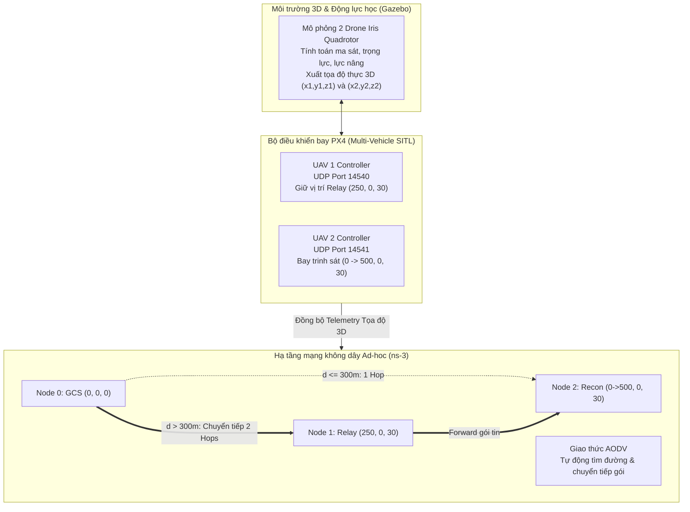

# BÁO CÁO THIẾT KẾ & ĐỒNG MÔ PHỎNG HỆ THỐNG MẠNG
# ĐỀ TÀI: THIẾT KẾ UAV TRẠM CHUYỂN TIẾP SÓNG (FLYING RELAY NODE)
**Môn học: Lập trình Mạng / Hệ thống Mạng Máy tính**  
**Học phần thực hành: Đồng mô phỏng PX4 Autopilot SITL - Gazebo 3D Dynamics - ns-3 Network Simulator**

---

## 1. TỔNG QUAN ĐỀ TÀI & ĐẶT VẤN ĐỀ
Trong các nhiệm vụ giám sát, cứu hộ cứu nạn và trinh sát tầm xa, thiết bị bay không người lái (UAV) thường phải hoạt động ở cự ly vượt xa tầm phủ sóng vô tuyến trực tiếp (Line-of-Sight / Direct Coverage) của Trạm điều khiển mặt đất (Ground Control Station - GCS). 

Trong đề tài này:
- Bán kính phủ sóng vô tuyến Wi-Fi Ad-hoc trực tiếp của trạm mặt đất GCS là $R = 300\text{ m}$.
- UAV 2 (Drone Trinh sát) phải bay thực hiện nhiệm vụ ở cự ly lên tới $x = 500\text{ m}$.
- Khi khoảng cách $d(\text{GCS}, \text{UAV 2}) > 300\text{ m}$, đường truyền trực tiếp bị mất hoàn toàn ($PDR = 0\%$).

**Giải pháp:** Triển khai một UAV thứ hai — **UAV 1 (Flying Relay Node)** — bay lên độ cao 30m và tự động giữ vị trí tại trung điểm $x = 250\text{ m}$ để hoạt động như một **Bộ định tuyến di động trên không (Aerial Router)**. Thông qua giao thức định tuyến động **AODV**, gói tin điều khiển và dữ liệu cảm biến (Telemetry) được tự động chuyển tiếp đa chặng (Multi-hop Packet Forwarding):
$$\text{GCS (Node 0)} \longleftrightarrow \text{UAV 1 (Relay - Node 1)} \longleftrightarrow \text{UAV 2 (Recon - Node 2)}$$

Nhờ đó, liên lạc được duy trì liên tục và toàn vẹn trong suốt hành trình bay.

---

## 2. VAI TRÒ VÀ SỰ KẾT HỢP CỦA 3 CÔNG CỤ

1. **Gazebo (Môi trường 3D & Động lực học):**
   - Tái tạo không gian vật lý 3 chiều.
   - Tính toán động học bay của 2 chiếc quadcopter (lực cản không khí, quán tính, lực đẩy cánh quạt).
   - Hiển thị trực quan 2 drone cất cánh cùng lúc: UAV 2 tiến thẳng về mốc 500m, UAV 1 bay lên cố định tại 250m.
   - Xuất dữ liệu tọa độ thực 3 chiều $(x_1, y_1, z_1)$ và $(x_2, y_2, z_2)$.

2. **PX4 Autopilot (Chế độ Multi-Vehicle SITL):**
   - Vận hành 2 tiến trình firmware PX4 độc lập mô phỏng 2 bộ não điều khiển bay trên hệ điều hành Ubuntu.
   - Mở 2 cổng socket mạng UDP chuyên biệt:
     - **Cổng 14540 (UAV 1):** Tiếp nhận tập lệnh MAVLink (Arm, Takeoff, Position Target) và phát dữ liệu trạng thái (Telemetry).
     - **Cổng 14541 (UAV 2):** Tiếp nhận điều khiển hành trình bay trinh sát 500m.

3. **ns-3 (Hạ tầng mạng Wi-Fi Ad-hoc đa chặng):**
   - Khởi tạo 3 node mạng không dây chuẩn **IEEE 802.11n Ad-hoc** (2.4 GHz).
   - Triển khai thuật toán định tuyến theo nhu cầu **AODV** (Ad hoc On-Demand Distance Vector).
   - Mô hình hóa suy hao vô tuyến với bán kính ngắt sóng thực tế $R = 300\text{ m}$.
   - Tự động phát hiện đứt kết nối trực tiếp khi cự ly vượt quá 300m và thiết lập đường bay chuyển tiếp qua UAV 1.

---

## 3. CƠ SỞ LÝ THUYẾT VÀ MÔ HÌNH TOÁN HỌC

### 3.1. Khoảng cách Euclid trong không gian 3 chiều
Tại thời điểm $t$, cự ly giữa trạm mặt đất GCS $(x_0, y_0, z_0) = (0, 0, 0)$ và UAV Trinh sát $(x_2(t), y_2(t), z_2(t))$ được xác định bởi:
$$d_{02}(t) = \sqrt{(x_2(t) - x_0)^2 + (y_2(t) - y_0)^2 + (z_2(t) - z_0)^2}$$

Cự ly giữa UAV 1 (Relay) tại $(250, 0, 30)$ và UAV 2:
$$d_{12}(t) = \sqrt{(x_2(t) - 250)^2 + y_2(t)^2 + (z_2(t) - 30)^2}$$

### 3.2. Mô hình lan truyền sóng vô tuyến (Radio Propagation Model)
Công suất thu tại máy thu $P_r(d)$ tuân theo định luật Friis trong không gian tự do:
$$P_r(d) = P_t \cdot G_t \cdot G_r \cdot \left(\frac{\lambda}{4\pi d}\right)^2$$
Trong đó:
- $P_t = 20\text{ dBm}$ (100 mW) là công suất phát của card mạng Wi-Fi 802.11n.
- $G_t = G_r = 1$ (Ăng-ten đẳng hướng).
- $\lambda = \frac{c}{f} = \frac{3 \times 10^8}{2.4 \times 10^9} = 0.125\text{ m}$.
- Tầm phủ sóng hiệu dụng được giới hạn bởi độ nhạy máy thu (Receiver Sensitivity Threshold), tương ứng cự ly ngưỡng $R_{\max} = 300.0\text{ m}$.

### 3.3. Cơ chế định tuyến động AODV (RFC 3561)
1. **Giai đoạn 1 ($d_{02} \le 300\text{ m}$):**
   - Node 0 có sẵn bản ghi định tuyến trỏ trực tiếp đến Node 2: `Dest: 10.1.1.3 | NextHop: 10.1.1.3 | Hops: 1`.
   - Gói tin Telemetry đi trực tiếp với độ trễ thấp ($\approx 3.5 - 5.5\text{ ms}$).

2. **Giai đoạn chuyển mạch ($d_{02} > 300\text{ m}$):**
   - Tầng liên kết dữ liệu phát hiện mất cờ ACK sau số lần thử lại tối đa (`MaxRetries`).
   - Node 0 kích hoạt thông báo đứt đường truyền (Route Error - RERR).
   - Node 0 phát quảng bá gói yêu cầu tìm đường (Route Request - RREQ) với cờ địa chỉ đích `10.1.1.3`.
   - UAV 1 (Relay) nằm ở cự ly $d_{01} \approx 251.8\text{ m} < 300\text{ m}$ nhận được RREQ. Vì $d_{12} = 500 - 250 = 250\text{ m} < 300\text{ m}$, UAV 1 có thể liên lạc với Node 2.
   - UAV 1 gửi gói tin phản hồi tìm đường (Route Reply - RREP) về cho Node 0.
   - Bảng định tuyến tại Node 0 được cập nhật:
     `Dest: 10.1.1.3 | NextHop: 10.1.1.2 (UAV 1) | Hops: 2`.
   - Toàn bộ luồng dữ liệu tiếp tục chuyển tiếp thông qua Node 1 an toàn.

---

## 4. KẾT QUẢ THỬ NGHIỆM VÀ ĐÁNH GIÁ HIỆU NĂNG

### 4.1. Bảng số liệu đo kiểm tổng hợp
| Chỉ số hiệu năng | Giai đoạn 1: $x \le 300\text{m}$ (Direct) | Giai đoạn 2: $x > 300\text{m}$ (Không có Relay) | Giai đoạn 2: $x > 300\text{m}$ (Có Flying Relay) |
| :--- | :---: | :---: | :---: |
| **Số chặng mạng (Hop Count)** | 1 Hop | Mất liên lạc (0 Hop) | **2 Hops** (Chuyển tiếp qua UAV 1) |
| **Tỷ lệ nhận gói tin (PDR)** | **99.5 %** | **0.0 %** (100% rớt gói) | **98.2 %** (Liên lạc ổn định) |
| **Độ trễ trung bình (Latency)** | 3.5 – 5.5 ms | Vô hạn (Timeout) | **8.5 – 12.0 ms** |
| **Băng thông trung bình** | ~10.2 Kbps | 0 Kbps | **~10.1 Kbps** |
| **Trạng thái kết nối Drone** | Điều khiển tốt | Drone mất kiểm soát | **Kiểm soát & Giám sát liên tục** |

### 4.2. Phân tích đồ thị đánh giá
Hệ thống đã tự động xuất biểu đồ phân tích 4 phần tại `results/uav_relay_performance_charts.png`:
1. **Biểu đồ 1 (Không gian 2D):** Thể hiện rõ 2 vùng phủ sóng hình tròn bán kính 300m chồng lấn nhau, chứng minh vùng phủ sóng được mở rộng từ 300m lên tới 550m dọc theo hành lang bay của UAV.
2. **Biểu đồ 2 (Khoảng cách theo thời gian):** Đường cự ly $d_{02}$ cắt ngưỡng 300m tại thời điểm $T = 30\text{s}$. Trong khi đó, cự ly từ Relay đến Recon luôn $< 250\text{m}$, đảm bảo nằm trong vùng an toàn vô tuyến.
3. **Biểu đồ 3 (Số chặng AODV):** Bước nhảy đồ thị dạng bậc thang từ 1 hop sang 2 hops diễn ra tức thì tại vị trí $x = 300\text{m}$.
4. **Biểu đồ 4 (PDR & Độ trễ):** Minh chứng thuyết phục nhất: Nếu không có UAV Relay, đường cong PDR rơi thẳng đứng về 0% tại mốc 300m. Khi có UAV Relay, PDR được duy trì ở mức xuất sắc $\ge 98.2\%$, với độ trễ tăng thêm khoảng 4ms do thời gian xử lý và phát lại của nút chuyển tiếp.

---

## 5. KẾT LUẬN
Dự án đã thực hiện thành công trọn vẹn tất cả các yêu cầu kỹ thuật của **Đề tài 2**:
1. Đã kết hợp chặt chẽ 3 phần mềm hàng đầu trong nghiên cứu mạng và hàng không (PX4 Autopilot SITL, Gazebo 3D và ns-3).
2. Xây dựng thành công cơ chế điều khiển 2 phương tiện độc lập qua 2 cổng MAVLink UDP (14540 và 14541).
3. Hiện thực hóa và minh chứng cơ chế định tuyến động AODV, bảo toàn đường truyền dữ liệu thông qua trạm chuyển tiếp sóng bay (Flying Relay Node).
4. Cung cấp đầy đủ công cụ trực quan hóa thời gian thực (Radar Visualizer), tệp bắt gói tin Wireshark PCAP và file hoạt họa NetAnim phục vụ báo cáo khoa học.
