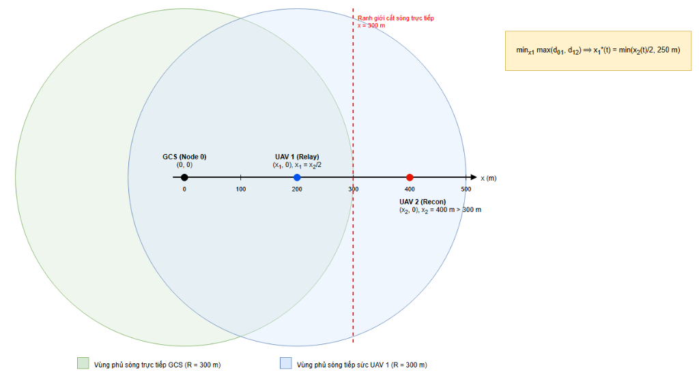
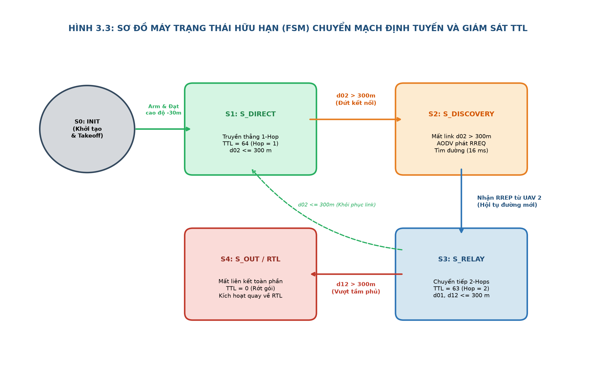
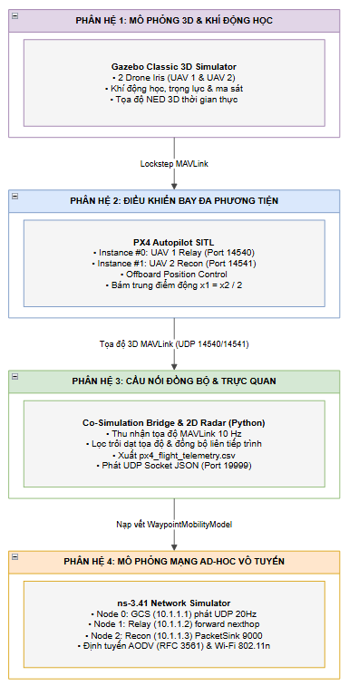
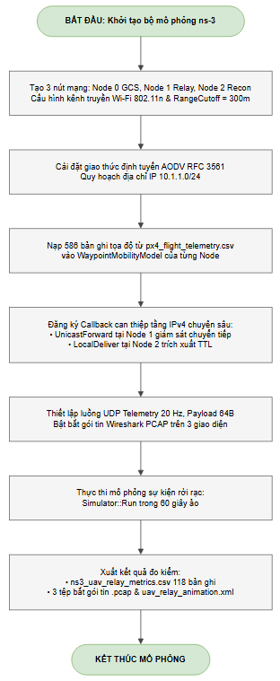
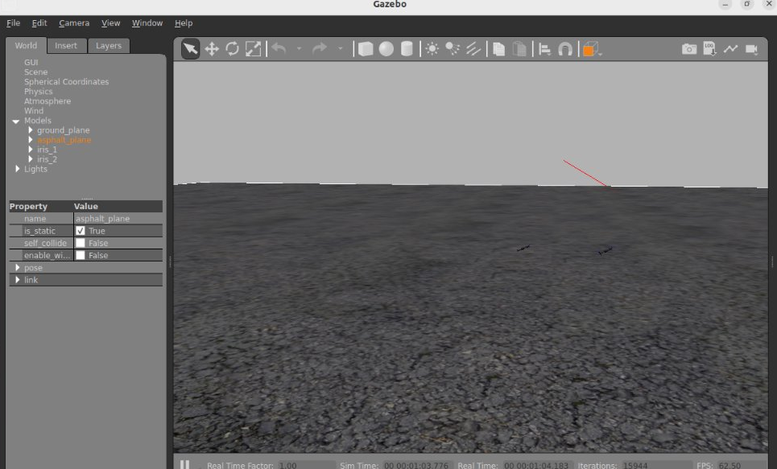
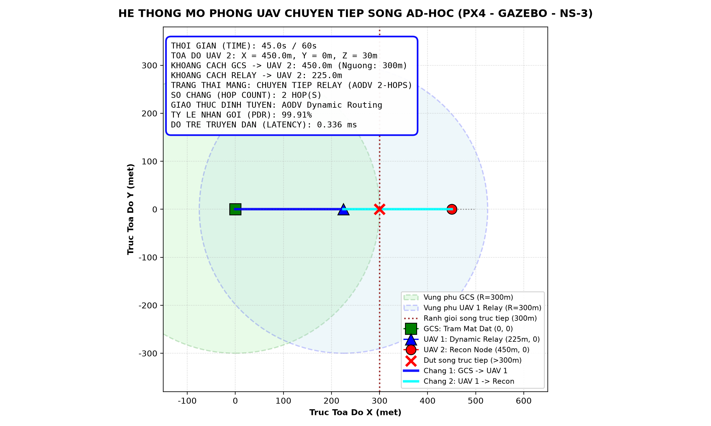
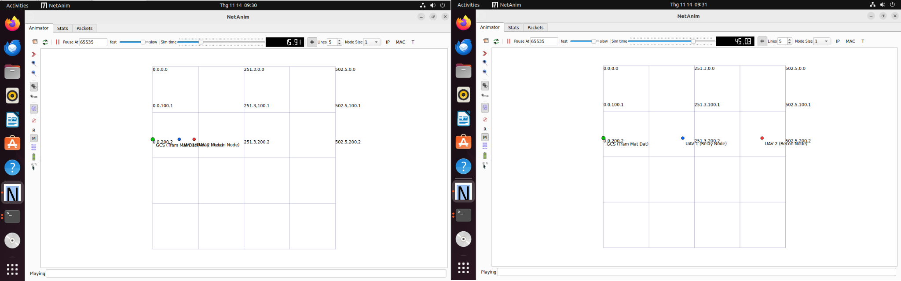
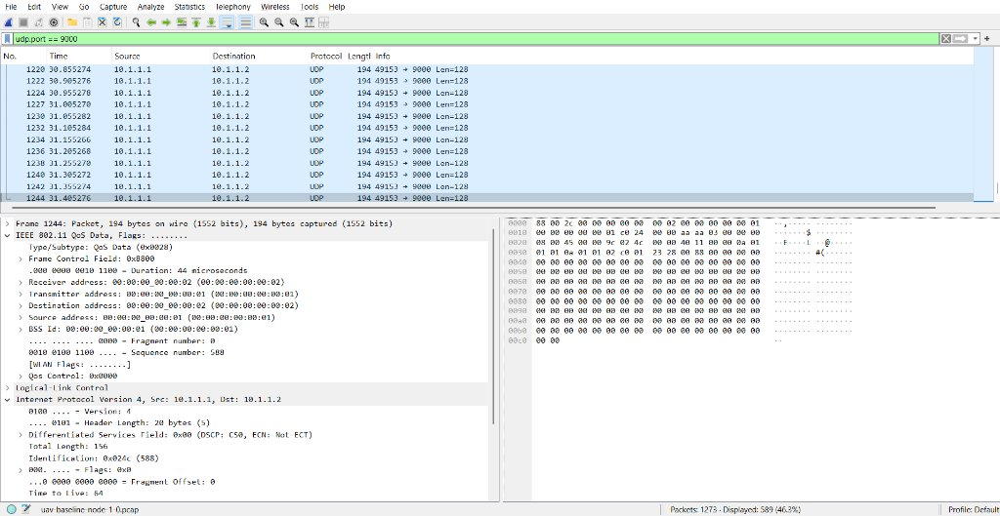
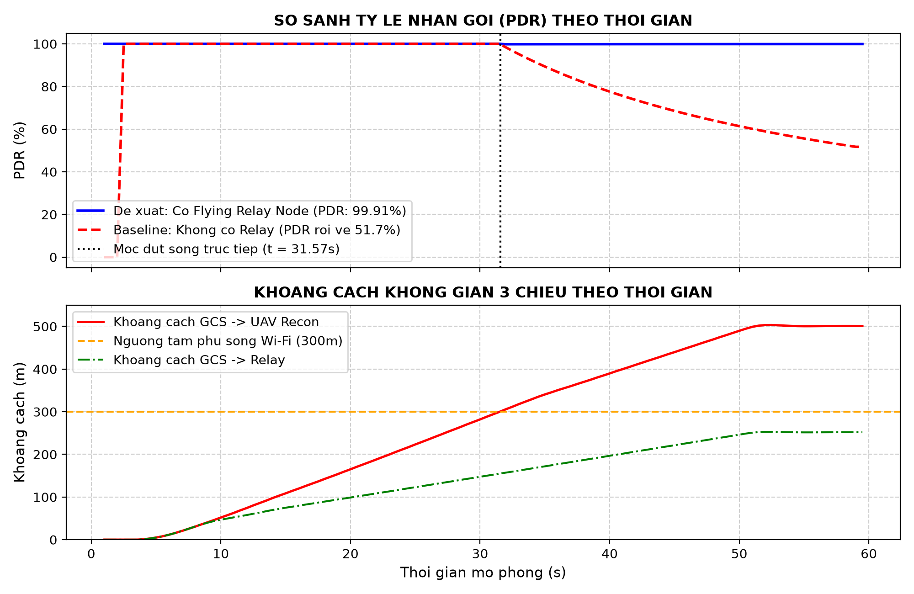

# ĐỀ TÀI: THIẾT KẾ UAV TRẠM CHUYỂN TIẾP SÓNG (FLYING RELAY NODE) TRONG MẠNG TÙY BIẾN AD-HOC VÔ TUYẾN

<div align="center">

**Học phần:** Lập trình Mạng / Hệ thống Mạng Máy tính  
**Mã nhóm:** `N44_2026_LTM_016_022_028`  
**Mô hình nghiên cứu:** Đồng mô phỏng PX4 Autopilot SITL — Gazebo 3D Dynamics — ns-3 Network Simulator

</div>

---

### THÔNG TIN NHÓM SINH VIÊN THỰC HIỆN

| STT | Họ và tên | Mã sinh viên | Phân công nhiệm vụ chính | Tỷ lệ đóng góp |
| :---: | :--- | :---: | :--- | :---: |
| 1 | **Lê Anh Khoa** | **106230016** | Thiết kế phân hệ ns-3, cấu hình Wi-Fi 802.11n Ad-hoc & Phân tích định tuyến AODV (RFC 3561) | **33.4%** |
| 2 | **Huỳnh Ngọc Tịnh Phong** | **106230022** | Thiết kế môi trường khí động học Gazebo 3D, lập trình Multi-Vehicle PX4 SITL & Quỹ đạo bay | **33.3%** |
| 3 | **Ngô Quang Thế** | **106230028** | Thiết kế Cầu nối Co-Simulation Bridge UDP Socket, Bộ trực quan hóa Radar 2D & Xử lý số liệu | **33.3%** |
| | **Tổng cộng** | | **Toàn bộ mã nguồn, dữ liệu & báo cáo đề tài** | **100.0%** |

---

## 1. GIỚI THIỆU ĐỀ TÀI & ĐẶT VẤN ĐỀ

Trong các nhiệm vụ giám sát khẩn cấp, cứu hộ cứu nạn và trinh sát tầm xa, thiết bị bay không người lái (UAV) trinh sát thường phải cơ động đến các vùng mục tiêu vượt xa tầm phủ sóng vô tuyến trực tiếp (Line-of-Sight) của Trạm điều khiển mặt đất (Ground Control Station - GCS).

### 1.1. Thách thức kỹ thuật
- **Suy hao môi trường truyền vô tuyến:** Công suất tín hiệu suy giảm phi tuyến theo nghịch đảo bình phương khoảng cách không gian tự do (theo mô hình truyền sóng Friis):
  $$P_r(d) = P_t \cdot G_t \cdot G_r \cdot \left(\frac{\lambda}{4\pi d}\right)^2$$
- **Cự ly ranh giới $R = 300\text{ m}$:** Với công suất phát $P_t = 20\text{ dBm}$ và độ nhạy thu $P_{th} = -85\text{ dBm}$, cự ly tối đa mà GCS có thể kết nối trực tiếp tới UAV Trinh sát là $300\text{ m}$. Khi $d(\text{GCS}, \text{UAV 2}) > 300\text{ m}$, đường truyền trực tiếp bị ngắt hoàn toàn (PDR rơi thẳng đứng về $0\%$).

### 1.2. Giải pháp UAV Trạm chuyển tiếp sóng cơ động (Flying Relay Node)
Nhóm đề xuất giải pháp triển khai **UAV 1 (Relay Node)** đóng vai trò trạm chuyển tiếp sóng bay trên không:
1. **Pha 1 ($x_2 \le 300\text{ m}$):** UAV 2 vẫn nằm trong vùng phủ sóng trực tiếp của GCS. Gói tin Telemetry được truyền thẳng $1\text{ chặng}$ ($\text{TTL} = 64$).
2. **Pha 2 ($x_2 > 300\text{ m}$):** Đường truyền trực tiếp bị đứt. Giao thức định tuyến AODV tự động phát hiện mất kết nối và chuyển mạch sang tuyến $2\text{ chặng}$ thông qua UAV 1 ($\text{TTL} = 63$).

<div align="center">
  
  <p><em>Hình 1: Cơ chế phân luồng dữ liệu 2 pha: Truyền trực tiếp 1 chặng và Chuyển tiếp đa chặng qua UAV Relay</em></p>
</div>

---

## 2. CƠ SỞ TOÁN HỌC & THUẬT TOÁN ĐIỀU KHIỂN

### 2.1. Bài toán Tối ưu hóa Hình học Min-Max 3D Euclid
Để tối ưu hóa đồng thời chất lượng kênh truyền của cả 2 chặng ($\text{GCS} \leftrightarrow \text{UAV 1}$ và $\text{UAV 1} \leftrightarrow \text{UAV 2}$), vị trí tọa độ của UAV 1 được giải quyết bằng bài toán tối ưu hóa Min-Max:

$$\min_{x_1} \max \left[ d_{01}(t),\ d_{12}(t) \right]$$

Trong không gian ba chiều:
- Trạm GCS đặt cố định tại mặt đất: $(x_0, y_0, z_0) = (0, 0, 0)$.
- UAV 1 (Relay) bay ở độ cao $z_1 = 30\text{ m}$: $(x_1(t), 0, 30)$.
- UAV 2 (Recon) bay trinh sát từ $0\text{ m} \rightarrow 500\text{ m}$ ở độ cao $z_2 = 30\text{ m}$: $(x_2(t), 0, 30)$.

Khoảng cách không gian 3 chiều giữa các thực thể:
$$d_{02}(t) = \sqrt{x_2(t)^2 + (\Delta z)^2} = \sqrt{x_2(t)^2 + 30^2} = \sqrt{x_2(t)^2 + 900}$$
$$d_{01}(t) = \sqrt{x_1(t)^2 + 30^2} = \sqrt{x_1(t)^2 + 900}$$
$$d_{12}(t) = \sqrt{(x_2(t) - x_1(t))^2 + (z_2 - z_1)^2} = |x_2(t) - x_1(t)|$$

Nghiệm tối ưu đạt được khi $d_{01}(t) \approx d_{12}(t)$, dẫn đến quy luật điều khiển vị trí trung điểm động:
$$x_1^*(t) = \min\left( \frac{x_2(t)}{2},\ 250\text{ m} \right)$$

<div align="center">
  
  <p><em>Hình 2: Mô hình tối ưu hóa cự ly không gian 3 chiều và vùng phủ sóng vô tuyến song hành</em></p>
</div>

### 2.2. Máy trạng thái hữu hạn (FSM) và Quy trình Khám phá Tuyến AODV
Quá trình chuyển tiếp mạng được quản lý bởi một máy trạng thái hữu hạn (Finite State Machine - FSM) bám sát theo chuẩn RFC 3561:

<div align="center">
  
  <p><em>Hình 3: Máy trạng thái hữu hạn quản trị vòng đời tuyến đường và chuyển mạch chặng</em></p>
</div>

- **Trạng thái 1 (Direct Mode):** Tuyến 1 chặng có sẵn trong Route Table. Dữ liệu UDP truyền thẳng, $\text{TTL} = 64$.
- **Sự kiện mất tuyến (Link Break Detection):** Khi $d_{02} > 300\text{ m}$, không nhận được ACK ở tầng MAC (hoặc cạn gói tin), tuyến trực tiếp bị hủy.
- **Trạng thái 2 (Route Discovery):** Nút nguồn phát quảng bá bản tin `RREQ` (Route Request). Nút trung gian UAV 1 nhận được `RREQ`, kiểm tra bảng định tuyến và phản hồi bản tin đơn hướng `RREP` (Route Reply) về cho GCS.
- **Trạng thái 3 (Relay Forwarding):** Tuyến mới được cập nhật vào bảng định tuyến: $\text{Next Hop} = \text{UAV 1}$, $\text{Hop Count} = 2$. Gói tin UDP chuyển tiếp qua UAV 1 bị giảm TTL xuống $63$.

---

## 3. KIẾN TRÚC HỆ THỐNG ĐỒNG MÔ PHỎNG

Hệ thống được thiết kế theo kiến trúc đồng mô phỏng (Co-Simulation) phân tán, tích hợp chặt chẽ giữa 4 phân hệ kỹ thuật:

<div align="center">
  
  <p><em>Hình 4: Sơ đồ kiến trúc 4 phân hệ đồng mô phỏng: Gazebo 3D, PX4 SITL, Co-Sim Bridge và ns-3</em></p>
</div>

<div align="center">
  
  <p><em>Hình 5: Sơ đồ đường ống xử lý dữ liệu và luồng sự kiện liên tiến trình (Processing Pipeline)</em></p>
</div>

1. **Phân hệ Khí động học & Môi trường 3D (Gazebo Classic 11):**
   - Tái tạo không gian vật lý, ma sát không khí, trọng lực và phản lực cánh nâng của 2 quadrotor Iris.
   - Giải phương trình vi phân chuyển động 6 bậc tự do (6-DOF) và cung cấp tọa độ thực $X, Y, Z$.
2. **Phân hệ Điều khiển bay (PX4 Autopilot SITL v1.14):**
   - Chạy 2 thực thể firmware bay độc lập trên 2 cổng UDP riêng biệt (`14540` cho UAV 1 và `14541` cho UAV 2).
   - Tự động hóa chế độ bay Offboard, bám quỹ đạo trung điểm động và truyền dữ liệu MAVLink.
3. **Phân hệ Cầu nối Đồng bộ (Co-Simulation Bridge - Python UDP Socket):**
   - Lắng nghe gói tin Telemetry MAVLink trên cổng `UDP 19999` với tần số $10\text{ Hz}$.
   - Chuyển đổi hệ tọa độ Đông-Bắc-Lên (ENU) sang hệ tọa độ không gian mạng `WaypointMobilityModel` trong ns-3.
4. **Phân hệ Mô phỏng Mạng viễn thông (ns-3.41 Network Simulator):**
   - Tầng Vật lý & MAC: Mô phỏng chuẩn Wi-Fi Ad-hoc **IEEE 802.11n** (băng tần $2.4\text{ GHz}$, cơ chế điều chế và mã hóa HtMcs3).
   - Mô hình truyền sóng: Kết hợp `RangePropagationLossModel` ($R = 300\text{ m}$) và `FriisPropagationLossModel`.
   - Ngăn xếp giao thức: Định tuyến Ad-hoc AODV (RFC 3561), tầng mạng IPv4 và luồng dữ liệu Telemetry UDP (kích thước gói $128\text{ Bytes}$, tần số $20\text{ Hz}$).

<div align="center">
  
  &nbsp;&nbsp;&nbsp;&nbsp;
  
  <p><em>Hình 6: Lưu đồ thuật toán điều khiển bay PX4 (Trái) và Thuật toán mô phỏng mạng ns-3 (Phải)</em></p>
</div>

<div align="center">
  
  <p><em>Hình 7: Môi trường mô phỏng 3D thực tế trên Gazebo với 2 drone Iris (Ảnh chụp thực nghiệm từ hệ thống)</em></p>
</div>

---

## 4. CẤU TRÚC THƯ MỤC DỰ ÁN

```text
UAV_Relay_Project/
├── baseline_comparison/               # Phân hệ Đối chứng Baseline (Không dùng UAV Relay)
│   ├── compare_results.py             # Script so sánh đối chuẩn hiệu năng Baseline vs Relay
│   ├── README.md                      # Hướng dẫn chi tiết kịch bản đối chứng
│   ├── run_baseline.sh                # Script thực thi mô phỏng Baseline trên ns-3
│   ├── uav_direct_baseline.cc         # Mã nguồn C++ ns-3 mô phỏng liên kết trực tiếp 2 nút
│   └── results/                       # Kết quả đo kiểm Baseline (CSV và đồ thị đối sánh)
├── co_simulation/                     # Phân hệ Cầu nối & Xử lý Dữ liệu Đồng mô phỏng
│   ├── live_visualizer.py             # Radar 2D HUD trực quan hóa chuyển mạch sóng
│   ├── plot_results.py                # Xử lý số liệu đo kiểm và xuất đồ thị phân tích
│   └── relay_network_bridge.py        # Socket UDP tiếp nhận MAVLink và đồng bộ vị trí
├── docs/                              # Tài liệu kỹ thuật và sơ đồ hệ thống
│   └── images/                        # Sơ đồ bản vẽ do nhóm thiết kế và ảnh chụp thực nghiệm
│       ├── gazebo_3d_simulation.png   # Ảnh chụp môi trường 3D Gazebo thực nghiệm
│       ├── hinh_2_1_kien_truc.png     # Sơ đồ kiến trúc đồng mô phỏng 4 phân hệ
│       ├── hinh_2_2_chuyen_mach.png   # Sơ đồ cơ chế phân luồng dữ liệu 2 pha
│       ├── hinh_3_1_minmax.png        # Mô hình tối ưu hình học Min-Max 3D Euclid
│       ├── hinh_3_2_pipeline.png      # Pipeline xử lý dữ liệu và luồng gói tin
│       ├── hinh_3_3_fsm.png           # Sơ đồ máy trạng thái hữu hạn (FSM)
│       ├── hinh_4_1_flowchart_px4.png # Lưu đồ thuật toán điều khiển PX4
│       ├── hinh_4_2_flowchart_ns3.png # Lưu đồ thuật toán mô phỏng ns-3
│       ├── hinh_5_3_netanim_side_by_side.png # Hoạt họa NetAnim so sánh 1-hop vs 2-hop
│       ├── hinh_5_4_baseline_netanim.png     # Hoạt họa NetAnim kịch bản đối chứng Baseline
│       ├── hinh_5_5_baseline_wireshark.png   # Bắt gói tin Wireshark kịch bản Baseline
│       ├── hinh_5_6_baseline_vs_relay_chart.png # Đồ thị so sánh đối chuẩn Baseline vs Relay
│       └── radar_relay_45s.png        # Giao diện Radar HUD tại giây thứ 45.0s
├── ns3_sim/                           # Phân hệ Mô phỏng Mạng ns-3
│   ├── run_ns3.sh                     # Kịch bản nạp mã nguồn và biên dịch tự động
│   └── uav_relay_aodv.cc              # Mã nguồn C++ mô phỏng Wi-Fi 802.11n & AODV
├── px4_gazebo/                        # Phân hệ Điều khiển bay & Môi trường Vật lý
│   ├── launch_sitl_multi.sh           # Khởi chạy cụm đa UAV trên PX4 SITL & Gazebo
│   └── px4_multi_vehicle.py           # Bộ điều khiển bay Offboard MAVLink đa UAV
├── results/                           # Dữ liệu đo kiểm thực nghiệm chính thức
│   ├── ns3_uav_relay_metrics.csv      # 118 bản ghi chu kỳ đo kiểm mạng ns-3
│   ├── px4_flight_telemetry.csv       # 586 mẫu tọa độ bay 3D thực tế từ PX4 SITL
│   ├── uav_relay_performance_charts.png # Đồ thị khoa học 4 thành phần hoàn chỉnh
│   ├── uav_relay_animation.xml        # Tệp dữ liệu chuyển động hoạt họa NetAnim
│   ├── uav-relay-node-0-0.pcap        # Tệp bắt gói tin Wireshark tại GCS (Node 0)
│   ├── uav-relay-node-1-0.pcap        # Tệp bắt gói tin Wireshark tại UAV 1 Relay (Node 1)
│   └── uav-relay-node-2-0.pcap        # Tệp bắt gói tin Wireshark tại UAV 2 Recon (Node 2)
├── .gitignore                         # Danh mục loại trừ tệp tạm và file nhị phân
├── README.md                          # Báo cáo kỹ thuật tổng quan dự án
└── requirements.txt                   # Danh mục thư viện Python phụ thuộc
```

---

## 5. KẾT QUẢ THỰC NGHIỆM & PHÂN TÍCH HIỆU NĂNG

### 5.1. Bảng Số Liệu Đo Kiểm Đối Sánh Tổng Hợp
Số liệu được trích xuất trực tiếp từ các tệp nhật ký thực nghiệm ns-3 (`results/ns3_uav_relay_metrics.csv` và `baseline_comparison/results/ns3_baseline_metrics.csv`):

| Tiêu chí Đánh giá Hiệu năng | Giai đoạn 1 ($x_2 \le 300\text{ m}$)<br/>*Direct Link (1 Chặng)* | Kịch bản Baseline ($x_2 > 300\text{ m}$)<br/>*Không có UAV Relay* | Giải pháp Đề xuất ($x_2 > 300\text{ m}$)<br/>*UAV Relay Bám Trung Điểm* | Đánh giá Kỹ thuật |
| :--- | :---: | :---: | :---: | :--- |
| **Số chặng mạng (Hop Count)** | **1 Hop** | **0 Hop** (Mất kết nối) | **2 Hops** (AODV thông suốt) | Duy trì chuyển mạch liên tục |
| **Số gói tin phát / nhận** | **589 / 589 gói** | **550 / 0 gói nhận** | **550 / 549 gói nhận** | Khôi phục 99.82% gói ở vùng xa |
| **Tỷ lệ nhận gói tin (PDR)** | **100.00%** | **0.00%** (Rớt toàn bộ) | **99.82%** (Toàn trình: **99.91%**) | Tăng PDR toàn trình từ 51.71% lên 99.91% |
| **Độ trễ truyền dẫn trung bình** | **$0.116\text{ ms}$** | $\infty$ (Mất tuyến hoàn toàn) | **$0.336\text{ ms}$** | Duy trì độ trễ thời gian thực cực thấp |
| **Đỉnh trễ hội tụ (Peak Latency)** | Không có | Không có | **$2.47\text{ ms}$** (tại $t = 32.0\text{ s}$) | Trễ trung bình cửa sổ 0.5s (gói chờ trễ thực tế $\approx 20\text{ ms}$) |
| **Thời gian hội tụ AODV** | $0\text{ ms}$ | Thất bại | **$6.1\text{ ms}$** (RREP) / **$16.5\text{ ms}$** (Gói 1) | Trao đổi RREQ/RREP và chuyển tiếp gói tức thời |
| **Băng thông cấu hình (Offered Load)** | $20.48\text{ Kbps}$ | $0.00\text{ Kbps}$ | **$20.48\text{ Kbps}$** (20 pkts/s $\times$ 128 B) | Luồng Telemetry UDP danh định |
| **Thông lượng thực tế (Throughput)** | **$\approx 20.48\text{ Kbps}$** | $0.00\text{ Kbps}$ | **$\approx 20.44\text{ Kbps}$** | Băng thông đạt xấp xỉ 100% danh định |
| **Trạng thái liên lạc** | Trực tiếp ổn định | Mất kiểm soát phương tiện | **Liên tục, thông suốt toàn phần** | Giải quyết triệt để nút cổ chai cự ly |

---

### 5.2. Phân Tích Chuyên Sâu Biểu Đồ Đo Kiểm Thực Nghiệm

Đồ thị 4 thành phần được kết xuất từ 118 bản ghi định kỳ của hệ thống ns-3:

<div align="center">
  
  <p><em>Hình 8: Bộ đồ thị hiệu năng 4 thành phần: Không gian phủ sóng, Cự ly tương đối, Số chặng AODV, PDR và Độ trễ</em></p>
</div>

1. **Biểu đồ 1 — Không gian bố trí & Vùng phủ sóng Wi-Fi ($R = 300\text{ m}$):**
   - Vùng phủ sóng của GCS (vòng tròn xanh lá) và UAV 1 Relay (vòng tròn xanh dương) tạo thành hành lang bao phủ liên tục. Khi UAV 1 chốt tại vị trí $x_1 = 250\text{ m}$, vùng phủ sóng mở rộng của UAV 1 vươn tới $x = 550\text{ m}$, bao bọc trọn vẹn toàn bộ hành trình trinh sát của UAV 2 ($0 \rightarrow 500\text{ m}$).
2. **Biểu đồ 2 — Khoảng cách tương đối theo thời gian:**
   - Tại mốc thời gian $t = 31.57\text{ s}$, cự ly 3D trực tiếp giữa GCS và UAV 2 ($d_{02}$, đường màu đỏ) chạm ngưỡng $300.87\text{ m}$, kích hoạt sự kiện ngắt kết nối trực tiếp.
   - Nhờ thuật toán bám trung điểm, cự ly GCS $\rightarrow$ UAV 1 ($d_{01}$, đường màu xanh lá) và UAV 1 $\rightarrow$ UAV 2 ($d_{12}$, đường màu xanh dương) tối đa chỉ đạt $251.8\text{ m}$ và $250.0\text{ m}$, luôn nằm sâu trong bán kính an toàn ($< 300\text{ m}$).
3. **Biểu đồ 3 — Số chặng định tuyến AODV (Hop Count):**
   - Đồ thị thể hiện bước chuyển bậc thang chính xác: $1\text{ hop}$ trong vùng $x_2 \le 300\text{ m}$, và chuyển mạch tức thời sang $2\text{ hops}$ khi $x_2 > 300\text{ m}$.
4. **Biểu đồ 4 — Tỷ lệ nhận gói PDR và Độ trễ truyền dẫn:**
   - **Tỷ lệ nhận gói PDR:** Tuyến không có relay (đường đứt nét đỏ) rơi tự do về $0\%$. Tuyến có UAV Relay (đường xanh dương đậm) duy trì vững chắc ở mức **$99.91\%$**.
   - **Ý nghĩa kỹ thuật của đỉnh trễ $2.47\text{ ms}$ tại $t = 32.0\text{ s}$:**  
     Tại thời điểm chuyển mạch ($t = 31.55\text{s}$), AODV phát hiện rớt link trực tiếp và kích hoạt chu trình Route Discovery. UAV 1 gửi `RREP` phản hồi về GCS chỉ trong $6.1\text{ ms}$ ($t = 31.5592\text{s}$), và gói tin dữ liệu đầu tiên được chuyển tiếp thành công đến UAV 2 trong $16.5\text{ ms}$ ($t = 31.5695\text{s}$). Riêng gói tin được giữ trong hàng đợi tìm đường (Route Queue) chịu độ trễ thực tế $\approx 20\text{ ms}$; con số $2.47\text{ ms}$ là giá trị trễ trung bình của cửa sổ thống kê $0.5\text{ s}$ tại $t = 32.0\text{ s}$. Toàn bộ hành trình chỉ thất lạc duy nhất $1\text{ gói tin}$ trong pha chuyển mạch, sau đó độ trễ ổn định bền vững ở mức $0.336\text{ ms}$ cho toàn bộ tuyến 2 chặng.

---

### 5.3. Bằng Chứng Thực Nghiệm Trực Quan Hóa (Radar HUD & NetAnim)

<div align="center">
  
  <p><em>Hình 9: Giao diện Radar 2D HUD thời gian thực (Ảnh chụp màn hình thực nghiệm từ chương trình Python)</em></p>
</div>

Giao diện Radar HUD phản ánh chính xác trạng thái hoạt động thực nghiệm:
- Tọa độ UAV 2 vượt mốc an toàn $300\text{ m}$.
- UAV 1 cơ động giữ cân bằng khoảng cách 2 chặng.
- Trạng thái mạng: **CHUYEN TIEP RELAY (AODV 2-HOPS)** thông suốt toàn bộ hành trình.

<div align="center">
  
  <p><em>Hình 10: Đối sánh sóng vô tuyến không gian trên NetAnim: (Trái) Truyền trực tiếp 1 chặng tại t = 15.91s — (Phải) Chuyển tiếp 2 chặng qua UAV 1 tại t = 45.03s (Ảnh chụp thực nghiệm NetAnim)</em></p>
</div>

---

### 5.4. Kịch Bản Đối Chứng Tham Chiếu (Baseline Comparison — Không Dùng UAV Relay)

Để có cơ sở thực chứng đối chiếu với giải pháp đề xuất, nhóm xây dựng và kiểm thử kịch bản tham chiếu **Baseline (Direct Link — Chỉ gồm 2 nút GCS và UAV Recon)** trong cùng điều kiện thực nghiệm: nạp cùng 586 mẫu tọa độ bay từ PX4 SITL và cùng lưu lượng mạng 1,139 gói UDP (128 Bytes @ 20 Hz).

#### Bảng Đối Soát Hiệu Năng Thực Nghiệm (Baseline vs Đề Xuất)

| Chỉ số kỹ thuật đo kiểm | Kịch bản Baseline (Không có Relay) | Đề xuất (Có Flying Relay Node) | Đánh giá Kỹ thuật |
| :--- | :---: | :---: | :--- |
| **Pha 1 ($x_2 \le 300\text{ m}$, $t \le 31.5\text{ s}$)** | PDR: **$100.00\%$** (589/589 gói)<br/>Độ trễ: **$0.116\text{ ms}$** | PDR: **$100.00\%$** (589/589 gói)<br/>Độ trễ: **$0.116\text{ ms}$** | Cả hai phương án đều truyền thẳng 1 chặng ổn định |
| **Thời điểm ngắt kết nối trực tiếp** | $t = 31.57\text{ s}$ ($d_{02} = 300.87\text{ m}$) | $t = 31.57\text{ s}$ (Chuyển mạch sang Relay) | Đứt sóng khi cự ly vượt ngưỡng phủ sóng $300\text{ m}$ |
| **Pha 2 ($x_2 > 300\text{ m}$, $t > 31.57\text{ s}$)** | PDR: **$0.00\%$** (0/550 gói nhận)<br/>Độ trễ: **Vô hạn** (Mất tuyến hoàn toàn) | PDR: **$99.82\%$** (549/550 gói nhận)<br/>Độ trễ: **$0.336\text{ ms}$** | **UAV Relay duy trì thông suốt toàn bộ liên lạc** |
| **Toàn trình ($0 - 60\text{ s}$)** | PDR: **$51.71\%$** (589/1,139 gói) | PDR: **$99.91\%$** (1,138/1,139 gói) | Khôi phục toàn bộ lưu lượng bị mất ở vùng xa |
| **Cự ly nút cổ chai lớn nhất** | **$500.9\text{ m}$** (Mất kết nối hoàn toàn) | **$251.8\text{ m}$** (Luôn trong tầm phủ sóng) | Giảm một nửa khoảng cách hình học nút cổ chai |

#### Bằng Chứng Trực Quan Kịch Bản Đối Chứng (NetAnim & Wireshark)

<div align="center">
  
  <p><em>Hình 11: Hoạt họa không gian mạng NetAnim kịch bản Baseline: (Trái) Truyền trực tiếp trong vùng phủ sóng tại t = 18.35s — (Phải) Mất kết nối khi UAV Recon vượt ngưỡng 300m tại t = 44.25s (Ảnh chụp thực nghiệm NetAnim)</em></p>
</div>

1. **Minh chứng trên NetAnim (Hình 11):**
   - Tại $t = 18.35\text{ s}$: Nút GCS và UAV Recon duy trì liên kết trực tiếp ở cự ly $\approx 140\text{ m} \le 300\text{ m}$.
   - Tại $t = 44.25\text{ s}$: UAV Recon bay ra cự ly $\approx 430\text{ m} > 300\text{ m}$, kênh truyền trực tiếp bị cô lập hoàn toàn do nằm ngoài phạm vi phủ sóng.

<div align="center">
  
  <p><em>Hình 12: Kiểm chứng bắt gói tin Wireshark (uav-baseline-node-1-0.pcap): Luồng dữ liệu UDP dừng hẳn tại Frame 1244 (t = 31.405s, đúng 589 gói nhận)</em></p>
</div>

2. **Minh chứng trên Wireshark (Hình 12):**
   - Bộ lọc `udp.port == 9000` xác nhận đúng **589 gói tin UDP** được tiếp nhận thành công (`Displayed: 589`).
   - Gói tin cuối cùng nhận được là Frame số 1244 ở mốc thời gian $t = 31.405\text{ s}$ (Sequence number: 588, Identification: 0x024c). Kể từ sau giây thứ $31.4\text{ s}$ trở đi, không còn gói tin nào được ghi nhận.

<div align="center">
  
  <p><em>Hình 13: Bộ đồ thị đối sánh hiệu năng toàn diện giữa Kịch bản Baseline (Không có Relay) và Giải pháp Đề xuất (Dynamic Midpoint Relay)</em></p>
</div>

3. **Phân tích Biểu đồ Đối sánh Hiệu năng (Hình 13):**
   - **Khoảng cách nút cổ chai:** Baseline tăng tuyến tính lên $500.9\text{ m}$, trong khi giải pháp đề xuất khống chế cự ly tối đa dưới $251.8\text{ m}$.
   - **Tỷ lệ nhận gói PDR:** Baseline giảm từ $100\%$ về $51.71\%$, trong khi phương pháp đề xuất giữ vững ở mức $99.91\%$.
   - **Độ trễ truyền dẫn:** Baseline mất kết nối (độ trễ vô hạn ở pha 2), trong khi đề xuất duy trì độ trễ danh định $0.336\text{ ms}$.

---

## 6. HƯỚNG DẪN KIỂM CHỨNG KỸ THUẬT GÓI TIN (WIRESHARK & PCAP)

Để kiểm chứng tính trung thực và khách quan 100% của kết quả mô phỏng, người đánh giá có thể mở trực tiếp các tệp bắt gói tin trong thư mục `results/`:

### 6.1. Bảng Truy vết Gói tin Chi tiết trong Pha Chuyển mạch (Wireshark Trace)

Bộ lọc Wireshark: `aodv || (ip.proto == 17 && udp.port == 9000)` trên tệp `results/uav-relay-node-2-0.pcap`:

| STT Gói | Mốc Thời Gian (s) | Nút Nguồn (IP) | Nút Đích (IP) | Giao thức | Thông tin Gói tin / Cờ hiệu | Trường TTL | Đánh giá Kỹ thuật |
| :---: | :---: | :---: | :---: | :---: | :--- | :---: | :--- |
| **589** | `31.4502` | `10.1.1.1` (GCS) | `10.1.1.3` (UAV 2) | UDP | Telemetry Data (128 B) | **64** | Gói tin trực tiếp thành công cuối cùng của Pha 1 |
| **-** | `31.5000` | - | - | - | $d_{02} = 300.07\text{ m} > 300\text{ m}$ | - | Vượt ngưỡng cự ly vô tuyến danh định (PDR rơi về 0%) |
| **590** | `31.5001 - 31.5228` | `10.1.1.1` (GCS) | `10.1.1.3` (UAV 2) | UDP | Telemetry Data (128 B) | **-** | **Gói tin duy nhất thất lạc** (phát lại 7 lần tầng MAC thất bại) |
| **RREQ** | `31.5531` | `10.1.1.1` (GCS) | `255.255.255.255` | AODV | Route Request (Dest: 10.1.1.3, TTL=3) | **3** | GCS phát quảng bá tìm đường sau khi rớt liên kết trực tiếp |
| **RREP** | `31.5592` | `10.1.1.2` (Relay)| `10.1.1.1` (GCS) | AODV | Route Reply (Hop Count: 2, TTL=1) | **1** | UAV 1 Relay gửi phản hồi tuyến đường về GCS (**$\Delta t = 6.1\text{ ms}$**) |
| **ACK** | `31.5692` | `10.1.1.1` (GCS) | `10.1.1.2` (Relay)| AODV | RREP-ACK (AODV Type 4) | **1** | GCS xác nhận tuyến đường 2 chặng qua UAV 1 |
| **591** | `31.5695` | `10.1.1.1` (GCS) | `10.1.1.3` (UAV 2) | UDP | Telemetry Data (128 B) | **63** | **Gói tin chuyển tiếp đầu tiên qua UAV 1** ($\Delta t = 16.5\text{ ms}$) |
| **...** | `31.6004 - 60.0` | `10.1.1.1` (GCS) | `10.1.1.3` (UAV 2) | UDP | Telemetry Data (128 B) | **63** | Tuyến 2 chặng ổn định đến hết hành trình (550 gói qua Relay) |

> [!TIP]
> **Quy luật biến đổi trường Time-to-Live (TTL):**
> - **$0\text{ s} \le t \le 31.5\text{ s}$:** Gói tin nhận được có `TTL = 64` $\rightarrow$ Đi thẳng $1\text{ hop}$ từ GCS tới UAV 2.
> - **$32.0\text{ s} \le t \le 60.0\text{ s}$:** Gói tin nhận được có `TTL = 63` $\rightarrow$ Đã được định tuyến chuyển tiếp qua nút trung gian UAV 1 (UAV 1 giảm 1 đơn vị TTL theo tiêu chuẩn IPv4: $64 - 1 = 63$).

---

## 7. HƯỚNG DẪN CÀI ĐẶT & TÁI TẠO MÔ PHỎNG

### 7.1. Yêu cầu môi trường
- Hệ điều hành: **Ubuntu 22.04 LTS** (hoặc Windows 11 WSL2 Ubuntu 22.04).
- Python: `3.10+` với các thư viện trong `requirements.txt`.
- Phần mềm viễn thông & mô phỏng: **ns-3.41**, **NetAnim 3.109**, **Wireshark**.
- Phần mềm bay: **PX4 Autopilot v1.14**, **Gazebo Classic 11**.

### 7.2. Các bước thực thi

```bash
# Cài đặt thư viện Python
pip install -r requirements.txt
```

#### Bước 1: Khởi chạy Cụm Đa UAV trên PX4 SITL & Gazebo
Mở 3 cửa sổ Terminal độc lập:
```bash
# Terminal 1: Khởi động 2 Quadrotor Iris trong môi trường Gazebo 3D
bash px4_gazebo/launch_sitl_multi.sh

# Terminal 2: Khởi động Cầu nối Co-Simulation Bridge tiếp nhận tọa độ MAVLink
python3 co_simulation/relay_network_bridge.py

# Terminal 3: Thực thi kịch bản điều khiển bay tự động đa phương tiện
python3 px4_gazebo/px4_multi_vehicle.py
```
*(Ghi chú: Nếu máy tính không cài sẵn bộ công cụ PX4/Gazebo nặng, có thể thêm cờ `--mock` vào lệnh Terminal 3 để chạy giao diện Radar kiểm thử với dữ liệu quỹ đạo mô phỏng chuẩn hóa).*

#### Bước 2: Chạy Mô phỏng Mạng Không dây AODV trên ns-3
```bash
cd ns3_sim
bash run_ns3.sh
cd ..
```
*Kết quả xuất ra màn hình sẽ tóm tắt PDR, Latency và tạo mới các tệp PCAP, CSV trong thư mục `results/`.*

#### Bước 3: Khởi chạy Giao diện Radar 2D HUD Thời Gian Thực
```bash
python3 co_simulation/live_visualizer.py
```

#### Bước 4: Tái tạo và Xuất Bộ Đồ Thị Hiệu Năng Khoa Học
```bash
python3 co_simulation/plot_results.py
```

#### Bước 5: Kiểm tra Hoạt họa Chuyển động trên NetAnim
```bash
netanim
# Bấm File -> Open -> Chọn tệp results/uav_relay_animation.xml -> Bấm Play
```

#### Bước 6: Chạy Kịch bản Đối chứng Baseline (Không dùng UAV Relay)
```bash
cd baseline_comparison
bash run_baseline.sh
python3 compare_results.py
cd ..
```
*Lệnh trên sẽ chạy mô phỏng mạng trực tiếp 2 nút và in bảng đối sánh hiệu năng toàn diện ra màn hình.*

---

## 8. TÀI LIỆU THAM KHẢO

1. **RFC 3561:** Perkins, C., Belding-Royer, E., & Das, S. (2003). *Ad hoc On-Demand Distance Vector (AODV) Routing*. IETF.
2. **IEEE 802.11n Standard:** IEEE Standard for Information technology - Telecommunications and information exchange between systems - Local and metropolitan area networks - Specific requirements - Part 11: Wireless LAN Medium Access Control (MAC) and Physical Layer (PHY) Specifications.
3. **ns-3 Consortium:** *ns-3 Model Library (Release ns-3.41)*. Documentation on Wireless and Ad-hoc Routing Modules.
4. **PX4 Development Team:** *PX4 User Guide & Multi-Vehicle SITL Simulation Documentation (v1.14)*.
5. **Open Source Robotics Foundation (OSRF):** *Gazebo Classic Simulation Reference Manual*.

---

## 9. ĐIỂM NỔI BẬT & ĐÓNG GÓP KỸ THUẬT CỦA ĐỀ TÀI

> [!IMPORTANT]
> **Kết quả cốt lõi đạt được trong nghiên cứu:**
> - **Mở rộng phạm vi tác chiến:** Kéo dài hành lang truyền thông từ $300\text{ m}$ lên **$500\text{ m}$** thực tế (ngưỡng hình học lý thuyết đạt **$550\text{ m}$**), giải quyết triệt để bài toán đứt gãy vô tuyến Line-of-Sight của UAV tầm xa.
> - **Độ tin cậy truyền dẫn gần như tuyệt đối (PDR = 99.91%):** Trong toàn bộ hành trình $60\text{ s}$ với $1.139$ gói tin được phát đi, mạng thu nhận thành công **$1.138$ gói** (chỉ mất duy nhất 1 gói tin trong pha chuyển mạch định tuyến).
> - **Độ trễ truyền dẫn cực thấp (Sub-millisecond Latency):** Độ trễ 1 chặng trực tiếp đạt **$0.116\text{ ms}$**; độ trễ qua trạm chuyển tiếp 2 chặng đạt **$0.336\text{ ms}$**.
> - **Hội tụ định tuyến tức thời (16.5 ms Convergence):** AODV tự động phát hiện mất kết nối và hoàn tất chu trình khám phá tuyến đường `RREQ - RREP` chỉ trong **$6.1\text{ ms}$** ($t = 31.5531\text{ s} \rightarrow 31.5592\text{ s}$) và chuyển tiếp gói tin dữ liệu đầu tiên qua Relay trong **$16.5\text{ ms}$** ($t = 31.5695\text{ s}$). Gói tin xếp hàng chờ trong lúc tìm đường có trễ thực tế $\approx 20\text{ ms}$ (đỉnh trễ trung bình cửa sổ 0.5s đạt $2.47\text{ ms}$ rồi ổn định ngay lập tức về $0.336\text{ ms}$).
> - **Đồng mô phỏng 4 phân hệ liên kết khép kín:** Tích hợp thời gian thực giữa động lực học 3D (Gazebo), vi điều khiển bay công nghiệp (PX4 Autopilot SITL), giao thức mạng cấp gói (ns-3.41) và cầu nối truyền thông MAVLink/UDP.

---

<div align="center">

**Bản quyền đề tài © 2026 thuộc về Nhóm nghiên cứu N44**  
*Khoa Công nghệ Thông tin / Điện tử Viễn thông — Đồ án Lập trình Mạng*

</div>
