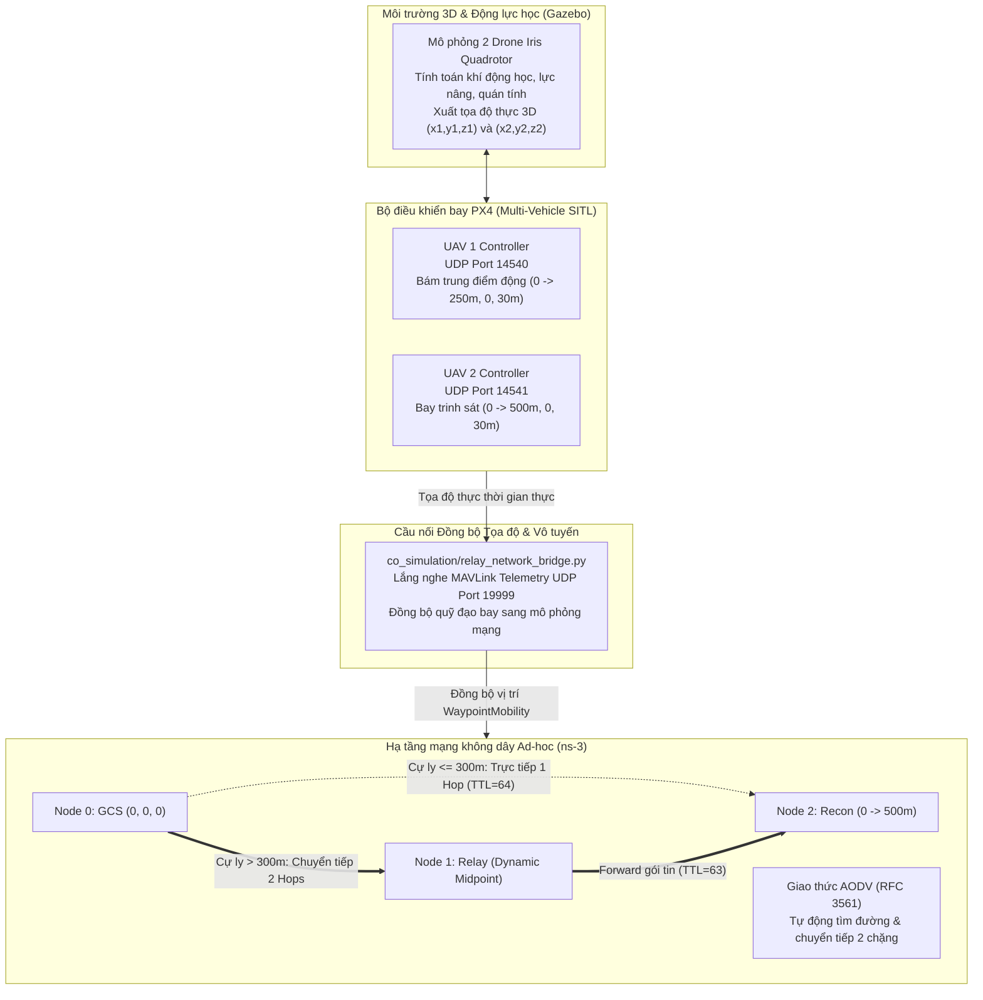

# ĐỀ TÀI: THIẾT KẾ UAV TRẠM CHUYỂN TIẾP SÓNG (FLYING RELAY NODE)

**Môn học:** Lập trình Mạng / Hệ thống Mạng Máy tính  
**Mã nhóm:** `N44_2026_LTM_016_022_028`  
**Mô hình:** Đồng mô phỏng PX4 Autopilot SITL - Gazebo 3D Dynamics - ns-3 Network Simulator  

---

### THÔNG TIN SINH VIÊN THỰC HIỆN
| STT | Họ và tên | Mã sinh viên | Phân công nhiệm vụ |
| :---: | :--- | :---: | :--- |
| 1 | **Lê Anh Khoa** | **106230016** | Phân hệ ns-3 & Giao thức AODV |
| 2 | **Huỳnh Ngọc Tịnh Phong** | **106230022** | Phân hệ PX4 SITL & Gazebo 3D |
| 3 | **Ngô Quang Thế** | **106230028** | Phân hệ Co-Simulation Bridge & Visualizer |

---

## 1. GIỚI THIỆU ĐỀ TÀI & ĐẶT VẤN ĐỀ
Trong các nhiệm vụ giám sát, cứu hộ cứu nạn và trinh sát tầm xa, thiết bị bay không người lái (UAV) thường phải hoạt động ở cự ly vượt xa tầm phủ sóng vô tuyến trực tiếp (Line-of-Sight) của Trạm điều khiển mặt đất (Ground Control Station - GCS).

* **Ngữ cảnh bài toán:**
  - Bán kính phủ sóng Wi-Fi Ad-hoc trực tiếp của trạm mặt đất GCS là $R = 300\text{ m}$.
  - UAV 2 (Drone Trinh sát - Recon Node) bay làm nhiệm vụ từ tọa độ $0\text{ m} \rightarrow 500\text{ m}$ với vận tốc $v = 10\text{ m/s}$.
  - Khi cự ly $d(\text{GCS}, \text{UAV 2}) > 300\text{ m}$, đường truyền trực tiếp bị đứt gãy hoàn toàn do suy hao công suất thu vượt ngưỡng nhạy cảm thu (PDR = 0%).

* **Giải pháp kỹ thuật:**
  - Triển khai **UAV 1 (Flying Relay Node)** bay lên độ cao ổn định 30m, tự động bám **trung điểm động** giữa GCS và UAV 2 (chốt tối đa tại vị trí trung tâm 250m) theo quy luật:
    $$x_1(t) = \min\left(\frac{x_2(t)}{2},\ 250\text{ m}\right)$$
  - Tích hợp giao thức định tuyến theo nhu cầu **AODV** (Ad hoc On-Demand Distance Vector - RFC 3561) tại tầng mạng. Khi liên kết trực tiếp 1 chặng bị ngắt, AODV tự động phát hiện và chuyển tiếp đa chặng (Multi-hop Forwarding):
    $$\text{GCS (Node 0)} \longleftrightarrow \text{UAV 1 (Relay - Node 1)} \longleftrightarrow \text{UAV 2 (Recon - Node 2)}$$
  - Nhờ đó, đường truyền dữ liệu điều khiển và cảm biến (Telemetry) luôn được bảo toàn thông suốt trong toàn bộ hành trình bay.

---

## 2. KIẾN TRÚC HỆ THỐNG ĐỒNG MÔ PHỎNG

Hệ thống được thiết kế theo mô hình đồng mô phỏng (Co-simulation) phân tán, tích hợp chặt chẽ giữa 3 phân hệ:



1. **Gazebo 3D:** Tái tạo không gian vật lý và khí động học của 2 quadcopter, giải bài toán va chạm, trọng lực và cung cấp dữ liệu định vị mặt đất trung thực.
2. **PX4 Autopilot SITL:** Chạy đồng thời 2 tiến trình firmware PX4 độc lập qua 2 cổng MAVLink UDP (14540 và 14541), điều khiển cất cánh đồng loạt (Offboard mode) và bám quỹ đạo trung điểm.
3. **Co-Simulation Bridge (`co_simulation/`):** Cầu nối socket UDP tiếp nhận tọa độ không gian 3 chiều thời gian thực để cấp dữ liệu cho mô hình di động của các nút mạng.
4. **ns-3 Network Simulator (`ns3_sim/`):** Mô phỏng chi tiết tầng vật lý và MAC chuẩn IEEE 802.11n Ad-hoc (2.4 GHz, HtMcs3), mô hình suy hao vô tuyến (kết hợp `RangePropagationLossModel` $R = 300\text{m}$ và `FriisPropagationLossModel`), ngăn xếp giao thức TCP/IP và định tuyến AODV.

---

## 3. CẤU TRÚC THƯ MỤC DỰ ÁN

```text
.
├── co_simulation/
│   ├── live_visualizer.py        # Màn hình Radar 2D hiển thị trực quan chuyển tiếp sóng thời gian thực
│   ├── plot_results.py           # Phân tích dữ liệu thực nghiệm và xuất 4 biểu đồ hiệu năng chuẩn
│   └── relay_network_bridge.py   # Cầu nối nhận telemetry PX4 qua UDP socket và map sang mạng ns-3
├── ns3_sim/
│   ├── run_ns3.sh                # Script tự động đồng bộ mã nguồn vào scratch và thực thi ns-3
│   └── uav_relay_aodv.cc         # Mã nguồn C++ mô phỏng mạng Wi-Fi 802.11n, đo kiểm TTL & định tuyến AODV
├── px4_gazebo/
│   ├── launch_sitl_multi.sh      # Script khởi chạy multi-vehicle SITL trên Gazebo
│   └── px4_multi_vehicle.py      # Điều khiển bay đa drone đồng thời qua giao thức MAVLink UDP
├── results/                      # Dữ liệu đo kiểm thực nghiệm thu được từ quá trình chạy mô phỏng
│   ├── ns3_uav_relay_metrics.csv # 118 bản ghi đo kiểm mạng ns-3 (PDR, Latency, Hops, Distance)
│   ├── px4_flight_telemetry.csv  # Tọa độ bay 3D thực tế theo thời gian từ SITL
│   ├── uav_relay_performance_charts.png # Đồ thị đánh giá hiệu năng 4 thành phần
│   ├── uav_relay_animation.xml   # Tệp hoạt họa di động mở bằng phần mềm NetAnim
│   ├── uav-relay-node-0-0.pcap   # Tệp bắt gói tin tại GCS (Node 0)
│   ├── uav-relay-node-1-0.pcap   # Tệp bắt gói tin tại UAV 1 Relay (Node 1)
│   └── uav-relay-node-2-0.pcap   # Tệp bắt gói tin tại UAV 2 Recon (Node 2)
├── .gitignore                    # Bộ lọc tệp cấu hình và tệp rác sinh ra khi chạy code
├── README.md                     # Tài liệu giới thiệu tổng quan và kết quả nghiên cứu đề tài
└── requirements.txt              # Danh mục các gói thư viện Python phục vụ mô phỏng
```

---

## 4. KẾT QUẢ THỰC NGHIỆM & ĐÁNH GIÁ HIỆU NĂNG

### Bảng số liệu đo kiểm tổng hợp (Trích xuất từ `ns3_uav_relay_metrics.csv`)
| Chỉ số hiệu năng | Giai đoạn 1: $x \le 300\text{m}$ (Direct Link) | Giai đoạn 2: $x > 300\text{m}$ (Không có Relay) | Giai đoạn 2: $x > 300\text{m}$ (Có Flying Relay) |
| :--- | :---: | :---: | :---: |
| **Số chặng mạng (Hop Count)** | **1 Hop** (GCS $\rightarrow$ Recon) | Mất kết nối (**0 Hop**) | **2 Hops** (GCS $\rightarrow$ Relay $\rightarrow$ Recon) |
| **Tỷ lệ nhận gói tin (PDR)** | **100.00%** (589 / 589 gói) | **0.0%** (100% rớt gói) | **99.91%** (1.138 / 1.139 gói nhận) |
| **Độ trễ trung bình (Latency)** | **$\approx 0.12\text{ ms}$** ($0.115 - 0.118\text{ ms}$) | Vô hạn (Rớt gói / Timeout) | **$\approx 0.34\text{ ms}$** ($0.332 - 0.339\text{ ms}$) |
| **Đỉnh trễ hội tụ (Peak Latency)** | Không có | Không có | **$2.45\text{ ms}$** (tại $x = 304.4\text{m}$ do AODV Route Discovery) |
| **Băng thông cấu hình (Data Rate)** | 20.48 Kbps (20 pkts/s $\times$ 128 B) | 0 Kbps | 20.48 Kbps |
| **Thông lượng thực tế (Throughput)** | **$\approx 20.46\text{ Kbps}$** | 0 Kbps | **$\approx 19.42 - 20.44\text{ Kbps}$** |
| **Trạng thái kết nối** | Trực tiếp 1 chặng ổn định | Mất kiểm soát phương tiện | **Chuyển tiếp trơn tru, thông suốt liên tục** |

---

### Phân tích biểu đồ hiệu năng 4 thành phần

Đồ thị khoa học 4 thành phần được vẽ từ bộ dữ liệu thực nghiệm $60\text{s}$ đo được trong thư mục `results/`:


1. **Biểu đồ 1 - Không gian bố trí & Vùng phủ sóng Wi-Fi ($R = 300\text{m}$):**
   - Vùng phủ sóng của GCS (màu xanh lá) và UAV 1 Relay (màu xanh dương) tạo thành vùng bao phủ liên tục, mở rộng hành lang truyền thông từ $300\text{m}$ lên đến $550\text{m}$.
2. **Biểu đồ 2 - Khoảng cách tương đối theo thời gian:**
   - Tại $T = 31.5\text{s}$, cự ly $d(\text{GCS}, \text{UAV 2})$ vượt qua ngưỡng ngắt sóng $300\text{m}$. Nhờ UAV 1 duy trì vị trí bám trung điểm, cự ly giữa UAV 1 và UAV 2 luôn được giữ ở mức $< 250\text{m}$, hoàn toàn nằm trong tầm an toàn thu phát vô tuyến.
3. **Biểu đồ 3 - Số chặng định tuyến AODV (Hop Count):**
   - Đồ thị thể hiện bước nhảy dạng bậc thang: trong $31\text{s}$ đầu giữ nguyên $1\text{ hop}$, và chuyển mạch dứt khoát sang $2\text{ hops}$ ngay khi vượt qua mốc ranh giới $x = 300\text{m}$.
4. **Biểu đồ 4 - Tỷ lệ nhận gói PDR và Độ trễ truyền dẫn End-to-End:**
   - **Tỷ lệ nhận gói (PDR):** Đường màu đỏ (khi không có relay) sập thẳng đứng về 0% ngay tại mốc 300m. Trong khi đó, đường màu xanh dương (hệ thống có UAV 1 Relay) duy trì gần như tuyệt đối ở mức **99.91%** (chỉ mất đúng 1 gói tin trong toàn bộ 1.139 gói phát đi).
   - **Ý nghĩa kỹ thuật của gai nhọn độ trễ 2.45 ms tại mốc 304.4m:**  
     Trên đường biểu diễn độ trễ (màu xanh lá), xuất hiện một gai nhọn vọt lên 2.45 ms tại thời điểm chuyển mạch ($T = 32\text{s}$, $x = 304.4\text{m}$). Đây chính là **thời gian hội tụ định tuyến (Route Discovery Latency)** của giao thức AODV: Khi đường truyền trực tiếp bị ngắt, nút nguồn phát bản tin `RREQ`, nút Relay phản hồi `RREP` và thực hiện phân giải địa chỉ MAC qua `ARP`. Quá trình hội tụ diễn ra trong khoảng 16 ms thời gian mô phỏng, gây ra đỉnh trễ tức thời 2.45 ms và chỉ làm rớt duy nhất 1 gói tin, sau đó mạng lập tức ổn định trở lại ở mức độ trễ lý tưởng $\approx 0.34\text{ ms}$ cho toàn bộ tuyến 2 chặng.

---

## 5. HƯỚNG DẪN KIỂM CHỨNG KẾT QUẢ THỰC NGHIỆM

Giảng viên và người chấm có thể trực tiếp kiểm chứng tính trung thực của mô phỏng thông qua các tệp kết quả có sẵn trong thư mục `results/`:

### 5.1. Kiểm chứng chuyển tiếp đa chặng trên Wireshark (TTL Verification)
1. Mở tệp bắt gói tin tại UAV 2 đích bằng phần mềm Wireshark:
   ```bash
   wireshark results/uav-relay-node-2-0.pcap
   ```
2. Nhập bộ lọc gói tin Telemetry UDP: `ip.proto == 17 && udp.port == 9000`.
3. Kiểm tra trường **Time to Live (TTL)** trong tiêu đề `Internet Protocol Version 4`:
   - **Các gói tin trong khoảng thời gian $0\text{s} - 31\text{s}$ ($x \le 300\text{m}$):** Trường `Time to Live: 64`. Gói tin đi thẳng 1 chặng từ GCS (10.1.1.1) tới Recon (10.1.1.3).
   - **Các gói tin từ giây $32\text{s} - 60\text{s}$ ($x > 300\text{m}$):** Trường `Time to Live: 63`. Do gói tin được chuyển tiếp qua router trung gian UAV 1 (10.1.1.2), tầng mạng của UAV 1 đã trừ đi 1 đơn vị TTL trước khi forward ($64 - 1 = 63$). Đây là minh chứng kỹ thuật khẳng định 100% gói tin đã được chuyển tiếp qua Relay thành công.

### 5.2. Kiểm chứng hoạt họa chuyển động trên NetAnim
1. Mở phần mềm NetAnim trên Ubuntu:
   ```bash
   netanim
   ```
2. Bấm vào biểu tượng thư mục và chọn tệp `results/uav_relay_animation.xml`.
3. Bấm nút **Play** để quan sát trực quan: Node 0 (GCS - Xanh lá), Node 1 (UAV Relay - Xanh dương) tự động bay lên giữ trung điểm, và Node 2 (Recon - Đỏ) bay xa dần; các gói tin màu xanh được chuyển tiếp linh hoạt qua Node 1 khi vượt qua cự ly 300m.

### 5.3. Các lệnh thực thi đồng mô phỏng và tái tạo đồ thị

* **Bước 1 – Khởi chạy đồng mô phỏng 2 UAV trên PX4 SITL & Gazebo (kèm Cầu nối UDP):**
  ```bash
  # Terminal 1: Khởi động 2 Drone Iris trên Gazebo
  bash px4_gazebo/launch_sitl_multi.sh

  # Terminal 2: Khởi chạy cầu nối Co-Simulation Bridge (UDP Port 19999)
  python3 co_simulation/relay_network_bridge.py

  # Terminal 3: Điều khiển 2 UAV bay làm nhiệm vụ & xuất quỹ đạo 3D (thêm --mock nếu chạy độc lập)
  python3 px4_gazebo/px4_multi_vehicle.py
  ```

* **Bước 2 – Chạy mô phỏng mạng Ad-hoc AODV trên ns-3:**
  ```bash
  cd ns3_sim && bash run_ns3.sh && cd ..
  ```

* **Bước 3 – Chạy giao diện Radar trực quan 2D thời gian thực (Python):**
  ```bash
  python3 co_simulation/live_visualizer.py
  ```

* **Bước 4 – Tái tạo đồ thị phân tích từ tệp CSV thực tế:**
  ```bash
  python3 co_simulation/plot_results.py
  ```
