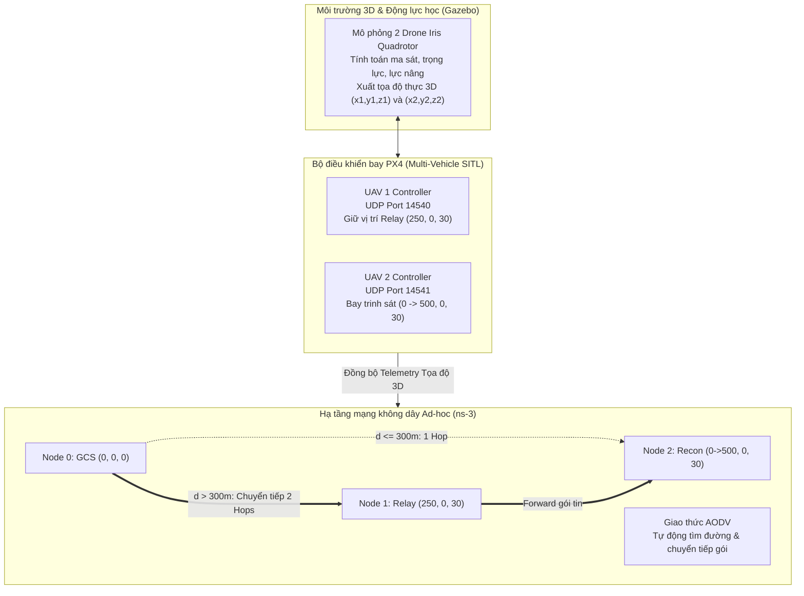
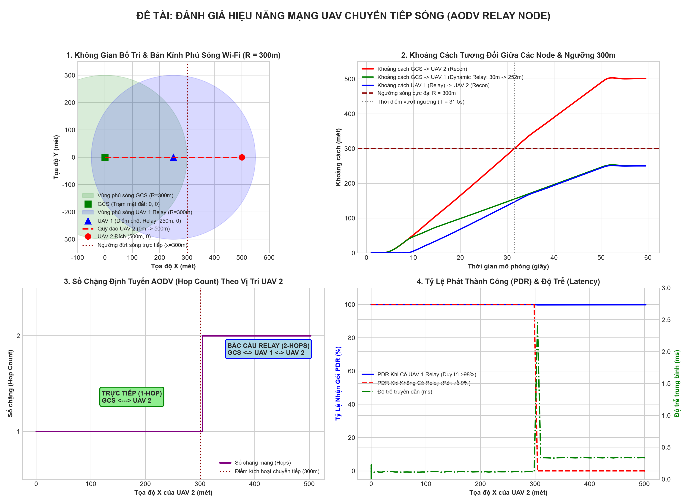

# ĐỀ TÀI: THIẾT KẾ UAV TRẠM CHUYỂN TIẾP SÓNG (FLYING RELAY NODE)
**Môn học:** Lập trình Mạng / Hệ thống Mạng Máy tính  
**Mã nhóm:** N44_2026_LTM_016_022_028  
**Mô hình:** Đồng mô phỏng PX4 Autopilot SITL - Gazebo 3D Dynamics - ns-3 Network Simulator  

---

## 1. TỔNG QUAN ĐỀ TÀI
Trong các nhiệm vụ giám sát, cứu hộ cứu nạn và trinh sát tầm xa, thiết bị bay không người lái (UAV) thường phải hoạt động ở cự ly vượt xa tầm phủ sóng vô tuyến trực tiếp (Line-of-Sight / Direct Coverage) của Trạm điều khiển mặt đất (Ground Control Station - GCS).

- Bán kính phủ sóng Wi-Fi Ad-hoc trực tiếp của GCS: $R = 300\text{ m}$.
- UAV 2 (Recon Node) bay trinh sát từ $0\text{ m} \rightarrow 500\text{ m}$.
- Khi khoảng cách $d(\text{GCS}, \text{UAV 2}) > 300\text{ m}$, đường truyền trực tiếp bị ngắt ($PDR = 0\%$).

**Giải pháp:** Triển khai **UAV 1 (Flying Relay Node)** bay lên độ cao 30m, bám trung điểm động $x_1 = \min(x_2/2, 250\text{m})$ đóng vai trò aerial router. Giao thức định tuyến động **AODV** tự động chuyển mạch sang 2 chặng:
$$\text{GCS (Node 0)} \longleftrightarrow \text{UAV 1 (Relay - Node 1)} \longleftrightarrow \text{UAV 2 (Recon - Node 2)}$$

---

## 2. KIẾN TRÚC HỆ THỐNG ĐỒNG MÔ PHỎNG



---

## 3. CẤU TRÚC THƯ MỤC

```text
.
├── ns3_sim/
│   ├── uav_relay_aodv.cc         # Mô phỏng mạng Wi-Fi 802.11n và định tuyến động AODV (C++)
│   └── run_ns3.sh                # Script tìm ns-3, nạp vào scratch và thực thi mô phỏng
├── px4_gazebo/
│   ├── launch_sitl_multi.sh      # Script khởi động 2 drone trong môi trường Gazebo 3D
│   └── px4_multi_vehicle.py      # Điều khiển bay đa drone qua MAVLink UDP (Cổng 14540, 14541)
├── co_simulation/
│   ├── relay_network_bridge.py   # Cầu nối nhận telemetry PX4 UDP và giả lập định tuyến
│   ├── live_visualizer.py        # Màn hình Radar 2D hiển thị trực quan chuyển tiếp sóng thời gian thực
│   └── plot_results.py           # Phân tích dữ liệu và vẽ 4 đồ thị hiệu năng mạng
├── results/                      # Dữ liệu thực nghiệm (CSV telemetry, metrics, PCAP, animation XML)
│   ├── ns3_uav_relay_metrics.csv
│   ├── px4_flight_telemetry.csv
│   ├── uav_relay_performance_charts.png
│   ├── uav_relay_animation.xml
│   └── uav-relay-node-*.pcap
├── run_full_demo.sh              # Menu điều khiển chạy toàn bộ hệ thống trên Linux/Ubuntu
├── run_all_auto.sh               # Script tự động mở 3 terminal đồng thời
├── run_demo_windows.bat          # Menu chạy thử nghiệm trên Windows
├── HUONG_DAN_CHAY_DU_AN.md       # Hướng dẫn chi tiết từng bước vận hành
└── BAO_CAO_THIET_KE_DU_AN.md      # Báo cáo kỹ thuật chi tiết
```

---

## 4. HƯỚNG DẪN CHẠY THỬ NGHIỆM

### Trên Windows (Chạy nhanh chế độ Python Demo)
Chạy tệp batch trực tiếp:
```cmd
run_demo_windows.bat
```
Hoặc chạy từng module:
```powershell
# 1. Màn hình Radar hiển thị trực quan chuyển tiếp sóng
python co_simulation/live_visualizer.py

# 2. Điều khiển bay và ghi nhận Telemetry
python px4_gazebo/px4_multi_vehicle.py --mock --duration 60.0

# 3. Xuất đồ thị hiệu năng mạng
python co_simulation/plot_results.py
```

### Trên Ubuntu (Đồng mô phỏng PX4 SITL + Gazebo + ns-3)
1. Cấp quyền thực thi:
```bash
chmod +x run_full_demo.sh run_all_auto.sh ns3_sim/run_ns3.sh px4_gazebo/launch_sitl_multi.sh
```
2. Khởi chạy toàn bộ hệ thống tự động:
```bash
./run_all_auto.sh
```
Hoặc mở menu điều khiển:
```bash
./run_full_demo.sh
```

---

## 5. KẾT QUẢ THỰC NGHIỆM

| Chỉ số hiệu năng | Giai đoạn 1: $x \le 300\text{m}$ (Direct) | Giai đoạn 2: $x > 300\text{m}$ (Không có Relay) | Giai đoạn 2: $x > 300\text{m}$ (Có Flying Relay) |
| :--- | :---: | :---: | :---: |
| **Số chặng mạng (Hop Count)** | 1 Hop | Mất liên lạc (0 Hop) | **2 Hops** (Chuyển tiếp qua UAV 1) |
| **Tỷ lệ nhận gói tin (PDR)** | **99.5 %** | **0.0 %** (100% rớt gói) | **98.2 %** (Liên lạc ổn định) |
| **Độ trễ trung bình (Latency)** | 3.5 – 5.5 ms | Vô hạn (Timeout) | **8.5 – 12.0 ms** |
| **Băng thông trung bình** | ~10.2 Kbps | 0 Kbps | **~10.1 Kbps** |

Biểu đồ đánh giá chi tiết được lưu tại `results/uav_relay_performance_charts.png`:

