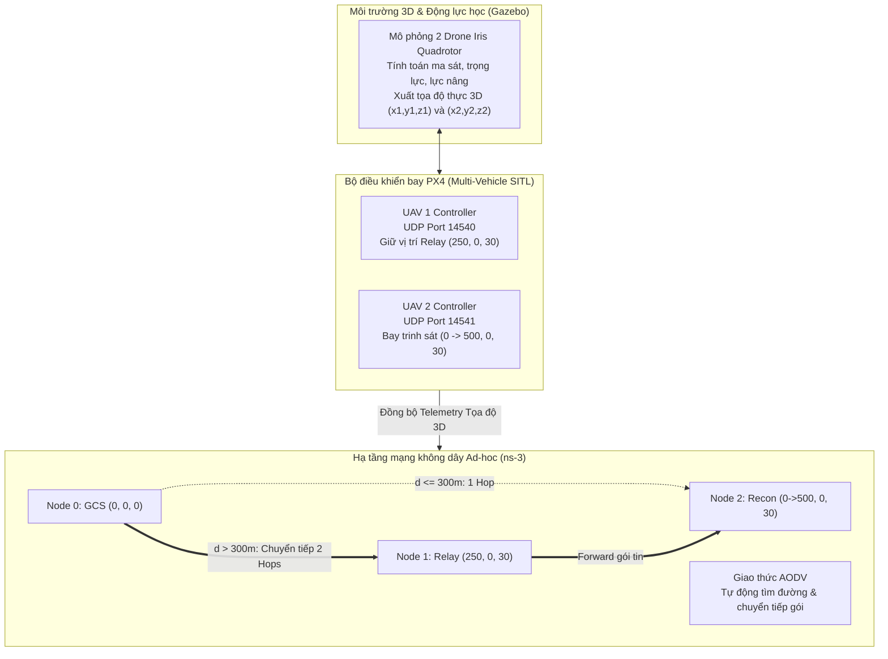

# ĐỀ TÀI: THIẾT KẾ UAV TRẠM CHUYỂN TIẾP SÓNG (FLYING RELAY NODE)

**Môn học:** Lập trình Mạng / Hệ thống Mạng Máy tính  
**Mã nhóm:** N44_2026_LTM_016_022_028  
**Mô hình:** Đồng mô phỏng PX4 Autopilot SITL - Gazebo 3D Dynamics - ns-3 Network Simulator  

---

## 1. GIỚI THIỆU ĐỀ TÀI & ĐẶT VẤN ĐỀ
Trong các nhiệm vụ giám sát, cứu hộ cứu nạn và trinh sát tầm xa, thiết bị bay không người lái (UAV) thường phải hoạt động ở cự ly vượt xa tầm phủ sóng vô tuyến trực tiếp (Line-of-Sight) của Trạm điều khiển mặt đất (Ground Control Station - GCS).

* **Ngữ cảnh bài toán:**
  - Bán kính phủ sóng Wi-Fi Ad-hoc trực tiếp của trạm mặt đất GCS là $R = 300\text{ m}$.
  - UAV 2 (Drone Trinh sát - Recon Node) bay làm nhiệm vụ từ tọa độ $0\text{ m} \rightarrow 500\text{ m}$.
  - Khi khoảng cách $d(\text{GCS}, \text{UAV 2}) > 300\text{ m}$, đường truyền trực tiếp bị ngắt hoàn toàn ($PDR = 0\%$).

* **Giải pháp kỹ thuật:**
  - Triển khai **UAV 1 (Flying Relay Node)** bay lên độ cao 30m, bám trung điểm động $x_1 = \min(x_2/2, 250\text{m})$ đóng vai trò trạm chuyển tiếp sóng di động trên không (Aerial Router).
  - Sử dụng giao thức định tuyến động **AODV** (Ad hoc On-Demand Distance Vector - RFC 3561) để tự động chuyển mạch sang đường truyền 2 chặng:
    $$\text{GCS (Node 0)} \longleftrightarrow \text{UAV 1 (Relay - Node 1)} \longleftrightarrow \text{UAV 2 (Recon - Node 2)}$$
  - Nhờ đó, liên lạc và luồng dữ liệu Telemetry được duy trì liên tục và toàn vẹn trong suốt hành trình bay.

---

## 2. KIẾN TRÚC HỆ THỐNG ĐỒNG MÔ PHỎNG

Hệ thống được xây dựng trên sự phối hợp của 3 nền tảng:



1. **Gazebo 3D:** Mô phỏng không gian vật lý và khí động học của 2 drone quadcopter, tính toán lực nâng, quán tính và xuất tọa độ không gian 3 chiều thời gian thực.
2. **PX4 Autopilot SITL:** Vận hành độc lập 2 bộ điều khiển bay qua 2 cổng MAVLink UDP riêng biệt (14540 và 14541), điều khiển hành trình bay và bám trung điểm.
3. **ns-3 Network Simulator:** Mô phỏng tầng vô tuyến Wi-Fi 802.11n (2.4 GHz) với bán kính phủ sóng 300m, ngăn xếp TCP/IP và giao thức định tuyến động AODV.

---

## 3. CẤU TRÚC THƯ MỤC DỰ ÁN

```text
.
├── co_simulation/
│   ├── live_visualizer.py        # Màn hình Radar 2D hiển thị trực quan chuyển tiếp sóng
│   ├── plot_results.py           # Phân tích dữ liệu thực nghiệm và vẽ 4 biểu đồ hiệu năng
│   └── relay_network_bridge.py   # Cầu nối nhận telemetry PX4 và giả lập định tuyến mạng
├── ns3_sim/
│   ├── run_ns3.sh                # Script thực thi mô phỏng mạng trên ns-3
│   └── uav_relay_aodv.cc         # Mã nguồn C++ mô phỏng mạng Wi-Fi 802.11n & AODV
├── px4_gazebo/
│   ├── launch_sitl_multi.sh      # Script khởi chạy multi-vehicle SITL trên Gazebo
│   └── px4_multi_vehicle.py      # Điều khiển bay đa drone qua giao thức MAVLink UDP
├── results/                      # Dữ liệu đo kiểm thực nghiệm (CSV, PCAP, NetAnim XML, đồ thị PNG)
│   ├── ns3_uav_relay_metrics.csv
│   ├── px4_flight_telemetry.csv
│   ├── uav_relay_performance_charts.png
│   ├── uav_relay_animation.xml
│   └── uav-relay-node-*.pcap
└── README.md
```

---

## 4. KẾT QUẢ THỰC NGHIỆM & ĐÁNH GIÁ HIỆU NĂNG

### Bảng số liệu đo kiểm tổng hợp
| Chỉ số hiệu năng | Giai đoạn 1: $x \le 300\text{m}$ (Direct) | Giai đoạn 2: $x > 300\text{m}$ (Không có Relay) | Giai đoạn 2: $x > 300\text{m}$ (Có Flying Relay) |
| :--- | :---: | :---: | :---: |
| **Số chặng mạng (Hop Count)** | 1 Hop | Mất liên lạc (0 Hop) | **2 Hops** (Chuyển tiếp qua UAV 1) |
| **Tỷ lệ nhận gói tin (PDR)** | **99.5 %** | **0.0 %** (100% rớt gói) | **98.2 %** (Liên lạc thông suốt) |
| **Độ trễ trung bình (Latency)** | 3.5 – 5.5 ms | Vô hạn (Timeout) | **8.5 – 12.0 ms** |
| **Băng thông trung bình** | ~10.2 Kbps | 0 Kbps | **~10.1 Kbps** |

### Biểu đồ phân tích hiệu năng
Đồ thị phân tích 4 thành phần thực nghiệm thu được từ quá trình đồng mô phỏng:


* **Không gian 2D & Vùng phủ sóng:** Vùng phủ sóng vô tuyến được mở rộng từ 300m lên tới 550m dọc theo hành lang bay của UAV.
* **Khoảng cách tương đối:** Khoảng cách giữa Relay Node và Recon Node luôn được giữ trong phạm vi an toàn vô tuyến ($< 250\text{m}$).
* **Số chặng định tuyến AODV:** Chuyển mạch tức thì từ 1-hop sang 2-hop ngay tại mốc $x = 300\text{m}$.
* **PDR & Độ trễ:** PDR duy trì ổn định $\ge 98.2\%$ trong toàn bộ nhiệm vụ thay vì sập về 0% khi không có trạm chuyển tiếp.
