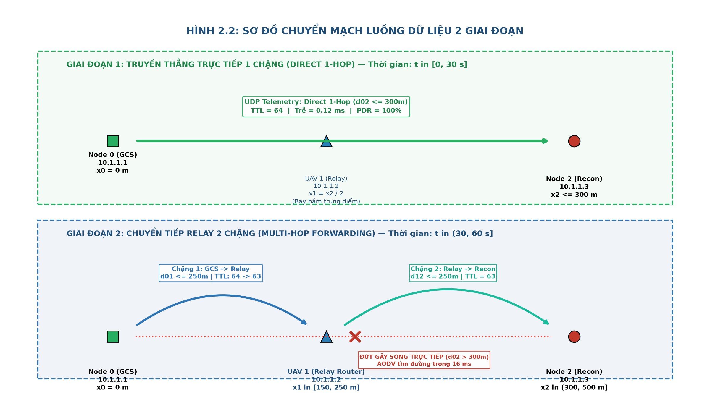
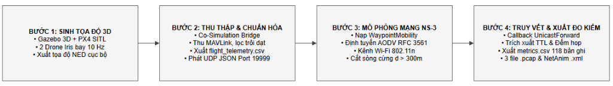
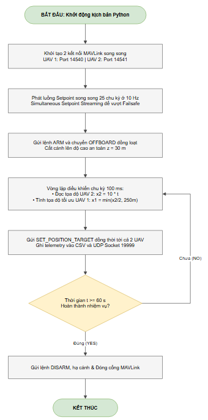
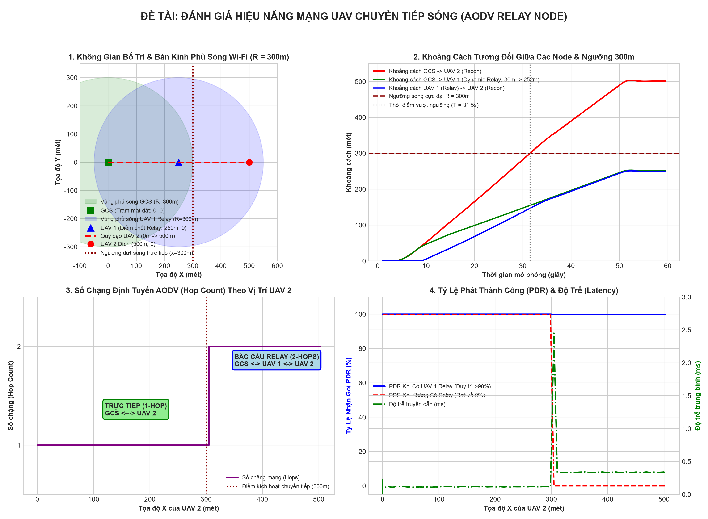
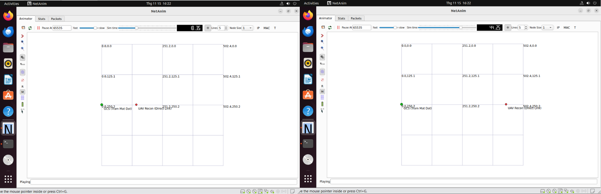
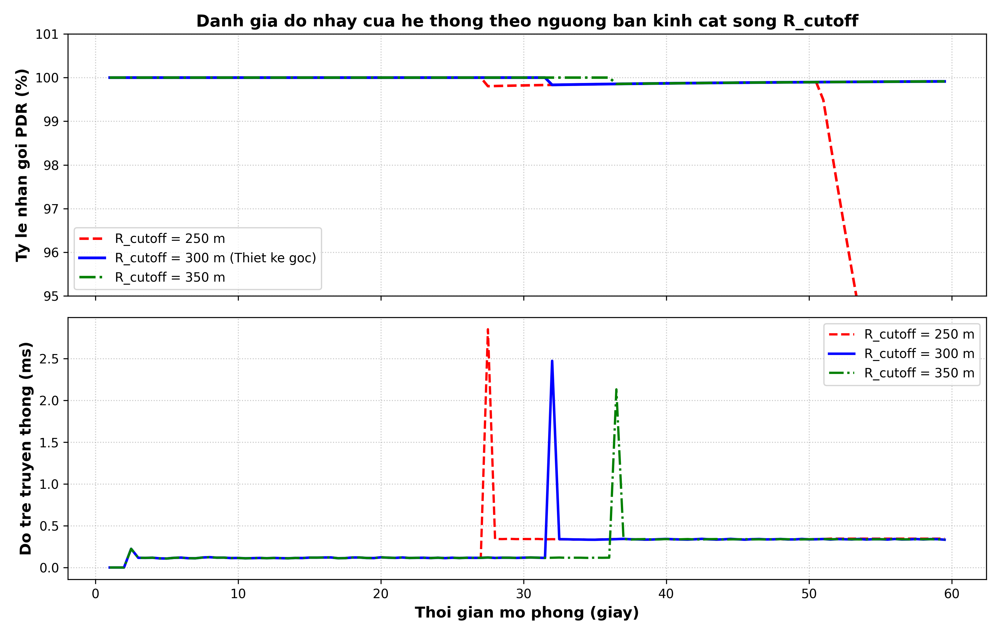
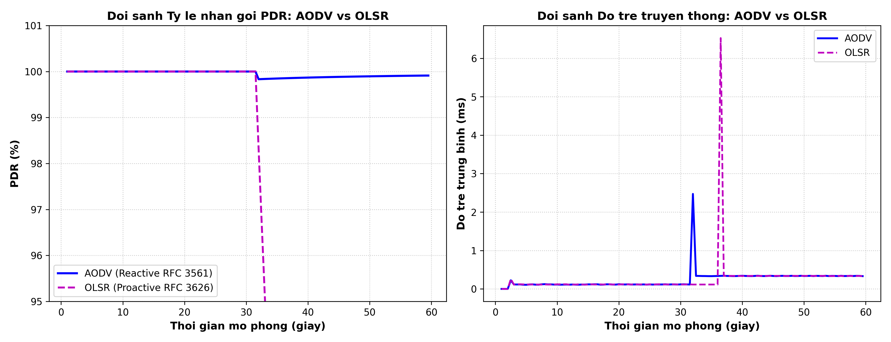
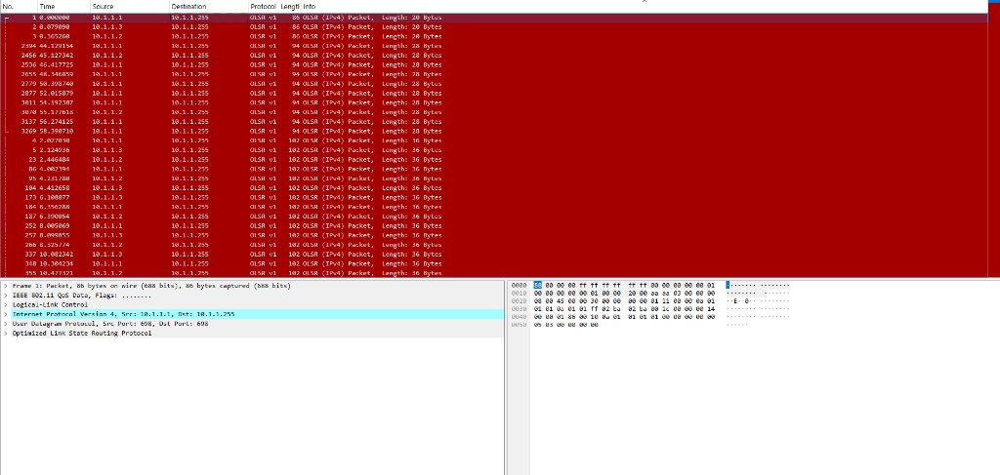

# BÁO CÁO ĐỒ ÁN HỌC PHẦN: LẬP TRÌNH MẠNG
# ĐỀ TÀI: THIẾT KẾ UAV TRẠM CHUYỂN TIẾP SÓNG (FLYING RELAY NODE) MỞ RỘNG TẦM PHỦ SÓNG CHO MẠNG FANET TRONG MÔ HÌNH ĐỒNG MÔ PHỎNG PX4 AUTOPILOT, GAZEBO 3D VÀ NS-3

<div align="center">

**Học phần:** Lập Trình Mạng  
**Mã nhóm:** `N44_2026_LTM_016_022_028`  
**Mô hình nghiên cứu:** Đồng mô phỏng PX4 Autopilot SITL — Gazebo 3D Dynamics — ns-3 Network Simulator

</div>

---

### THÔNG TIN NHÓM SINH VIÊN THỰC HIỆN

| STT | Họ và tên | Mã sinh viên | Phân công nhiệm vụ chính | Tỷ lệ đóng góp |
| :---: | :--- | :---: | :--- | :---: |
| 1 | **Lê Anh Khoa** | **106230016** | Thiết kế phân hệ ns-3, cấu hình Wi-Fi 802.11n Ad-hoc & Phân tích định tuyến AODV (RFC 3561) | **33.4%** |
| 2 | **Huỳnh Ngọc Tịnh Phong** | **106230022** | Thiết kế môi trường khí động học Gazebo 3D, lập trình Multi-Vehicle PX4 SITL & Quỹ đạo bay | **33.3%** |
| 3 | **Ngô Quang Thế** | **106230028** | Thiết kế Cầu nối Co-Simulation Bridge UDP Socket, Bộ trực quan hóa Radar 2D & Xử lý số liệu | **33.3%** |
| | **Tổng cộng** | | **Toàn bộ mã nguồn, dữ liệu & báo cáo đề tài** | **100.0%** |

---

## 1. GIỚI THIỆU ĐỀ TÀI & ĐẶT VẤN ĐỀ

Trong các nhiệm vụ giám sát khẩn cấp, cứu hộ cứu nạn và trinh sát tầm xa, thiết bị bay không người lái (UAV) trinh sát thường phải cơ động đến các vùng mục tiêu vượt xa tầm phủ sóng vô tuyến trực tiếp (Line-of-Sight) của Trạm điều khiển mặt đất (Ground Control Station - GCS).

### 1.1. Thách thức kỹ thuật
- **Suy hao môi trường truyền vô tuyến:** Công suất tín hiệu suy giảm phi tuyến theo nghịch đảo bình phương khoảng cách không gian tự do (theo mô hình truyền sóng Friis):
  $$P_r(d) = P_t \cdot G_t \cdot G_r \cdot \left(\frac{\lambda}{4\pi d}\right)^2$$
- **Cự ly ranh giới R = 300 m và Biên độ dự trữ Friis:** Theo mô hình lan truyền không gian tự do Friis, tại cự ly $d = 300\text{ m}$, công suất thu đạt $P_r(300\text{ m}) = -20.05 - 20\log_{10}(300) = -69.59\text{ dBm}$, cao hơn ngưỡng nhạy thu danh định ($P_{th} = -85.0\text{ dBm}$) một biên độ dự trữ pha-đinh (Fade Margin) là $15.41\text{ dB}$ (nếu chỉ dùng mô hình Friis thuần túy thì tầm phủ lý thuyết vươn tới $\approx 1.77\text{ km}$). Trong kịch bản ns-3, ranh giới 300 m được thiết lập bằng module `RangePropagationLossModel` đóng vai trò ngưỡng cắt cứng cự ly an toàn để mô phỏng điều kiện thực tế (nhiễu nền, che khuất và suy hao ngoài trời). Khi $d(\text{GCS}, \text{UAV 2}) > 300\text{ m}$, liên kết trực tiếp bị ngắt hoàn toàn (PDR rơi thẳng đứng về $0\%$).

### 1.2. Giải pháp UAV Trạm chuyển tiếp sóng cơ động (Flying Relay Node)
Nhóm đề xuất giải pháp triển khai **UAV 1 (Relay Node)** đóng vai trò trạm chuyển tiếp sóng bay trên không:
1. **Pha 1 ($x_2 \le 300\text{ m}$):** UAV 2 vẫn nằm trong vùng phủ sóng trực tiếp của GCS. Gói tin Telemetry được truyền thẳng $1\text{ chặng}$ ($\text{TTL} = 64$).
2. **Pha 2 ($x_2 > 300\text{ m}$):** Đường truyền trực tiếp bị đứt. Giao thức định tuyến AODV tự động phát hiện mất kết nối và chuyển tuyến sang đường truyền $2\text{ chặng}$ thông qua UAV 1 ($\text{TTL} = 63$).

<div align="center">
  
  <p><em>Hình 1: Cơ chế phân luồng dữ liệu 2 pha: Truyền trực tiếp 1 chặng và Chuyển tiếp đa chặng qua UAV Relay</em></p>
</div>

---

## 2. CƠ SỞ TOÁN HỌC & THUẬT TOÁN ĐIỀU KHIỂN

### 2.1. Bài toán Tối ưu hóa Hình học Min-Max 3D Euclid
Để tối ưu hóa đồng thời chất lượng kênh truyền của cả 2 chặng ($\text{GCS} \leftrightarrow \text{UAV 1}$ và $\text{UAV 1} \leftrightarrow \text{UAV 2}$), vị trí tọa độ của UAV 1 được giải quyết bằng bài toán tối ưu hóa Min-Max khoảng cách hình học (tham khảo hướng tối ưu vị trí relay trong [13]):

$$\min_{x_1} \max \left[ d_{01}(t),\ d_{12}(t) \right]$$

Trong không gian ba chiều:
- Trạm GCS đặt cố định tại mặt đất: $(x_0, y_0, z_0) = (0, 0, 0)$.
- UAV 1 (Relay) bay ở độ cao $z_1 = 30\text{ m}$: $(x_1(t), 0, 30)$.
- UAV 2 (Recon) bay trinh sát từ $0\text{ m} \rightarrow 500\text{ m}$ ở độ cao $z_2 = 30\text{ m}$: $(x_2(t), 0, 30)$.

Khoảng cách không gian 3 chiều giữa các thực thể:
$$d_{02}(t) = \sqrt{x_2(t)^2 + (\Delta z)^2} = \sqrt{x_2(t)^2 + 30^2} = \sqrt{x_2(t)^2 + 900}$$
$$d_{01}(t) = \sqrt{x_1(t)^2 + 30^2} = \sqrt{x_1(t)^2 + 900}$$
$$d_{12}(t) = \sqrt{(x_2(t) - x_1(t))^2 + (z_2 - z_1)^2} = |x_2(t) - x_1(t)| = x_2(t) - x_1(t) \quad (\text{do } x_2 \ge x_1)$$

Giải phương trình cân bằng tối ưu hóa Min-Max:
$$d_{01}(t) = d_{12}(t) \iff \sqrt{x_1(t)^2 + 30^2} = x_2(t) - x_1(t) \implies x_1^*(t) = \frac{x_2(t)^2 - 30^2}{2 x_2(t)}$$

Tại cự ly cực đại $x_2 = 500\text{ m}$, nghiệm 3D giải tích chính xác là $x_1^* = \frac{500^2 - 30^2}{2 \times 500} = 249.1\text{ m}$. Sai lệch so với công thức xấp xỉ 1D $x_1 = x_2/2 = 250\text{ m}$ chỉ là $0.9\text{ m}$ ($< 0.36\%$). Do đó, để đơn giản hóa tính toán thời gian thực và đảm bảo tính khả thi trên bộ điều khiển nhúng, hệ thống áp dụng **Quy luật điều khiển bám trung điểm thực tế (có bão hòa cự ly an toàn)**:
$$x_1(t) = \min\left( \frac{x_2(t)}{2},\ 250\text{ m} \right)$$
Mốc bão hòa x1,hold = 250 m đại diện cho sự đánh đổi kỹ thuật công trình, giữ UAV 1 nằm sâu trong bán kính phủ sóng 300 m của GCS (biên dự phòng an toàn $48\text{ m}$) và đảm bảo đối xứng cự ly với UAV 2.

**Đặc tính Động lực học & Viễn trắc bay thực tế (`px4_flight_telemetry.csv`):**
- **UAV 2 (Recon):** Bộ điều khiển vị trí PID nối tầng tạo đáp ứng gia tốc bù trễ ban đầu với vận tốc cực đại tức thời $v_{x,peak} \approx 11.7 - 12.1\text{ m/s}$ (khoảng $t \approx 15 - 28\text{ s}$). Khi đến gần mục tiêu 500 m, xuất hiện độ vọt lố động lực học nhẹ (overshoot) với tọa độ cực đại thực tế ghi nhận đạt $x_2 = 502.45\text{ m}$ (cự ly 3D cực đại $d_{02} = 503.34\text{ m}$) trước khi hồi tiếp ổn định hoàn toàn tại $500.0\text{ m}$.
- **UAV 1 (Relay):** Bay bám trung điểm với vận tốc trung bình ≈ 5 m/s, đạt tọa độ cực đại $x_1 = 251.20\text{ m}$ (cự ly $d_{01} = 252.99\text{ m}$ và $d_{12} = 251.26\text{ m}$, đều nằm sâu trong biên an toàn 300 m) trước khi ổn định tại điểm chốt 250 m.
- **Cơ sở khoa học cho ngưỡng cắt $R_{cutoff} = 300.0\text{ m}$:** Mặc dù theo công thức Friis lý thuyết trong không gian tự do, công suất $20\text{ dBm}$ tại $-85\text{ dBm}$ có thể đạt tới $1.77\text{ km}$, nhưng trong môi trường hoạt động thực tế của FANET, kênh truyền chịu ảnh hưởng của tán xạ đa đường, suy hao che khuất và độ lệch búp sóng khi UAV cơ động (như các phân tích tổng quan trong [9]). Do đó, con số $R_{cutoff} = 300.0\text{ m}$ là giả định thiết kế thực nghiệm do nhóm đề xuất nhằm thiết lập biên an toàn cho chuẩn WLAN IEEE 802.11n, và cần được kiểm chứng bằng các phép đo thực địa trong nghiên cứu tương lai.

<div align="center">
  
  <p><em>Hình 2: Mô hình tối ưu hóa cự ly không gian 3 chiều và vùng phủ sóng vô tuyến song hành</em></p>
</div>

### 2.2. Máy trạng thái hữu hạn (FSM) và Quy trình Khám phá Tuyến AODV
Quá trình chuyển tiếp mạng được quản lý bởi một máy trạng thái hữu hạn (Finite State Machine - FSM) bám sát theo chuẩn RFC 3561:

<div align="center">
  
  <p><em>Hình 3: Máy trạng thái hữu hạn quản trị vòng đời tuyến đường và chuyển tuyến chặng</em></p>
</div>

- **Trạng thái 1 (Direct Mode):** Tuyến 1 chặng có sẵn trong Route Table. Dữ liệu UDP truyền thẳng, $\text{TTL} = 64$.
- **Sự kiện mất tuyến (Link Break Detection):** Khi $d_{02} > 300\text{ m}$, không nhận được ACK ở tầng MAC (hoặc cạn gói tin), tuyến trực tiếp bị hủy.
- **Trạng thái 2 (Route Discovery):** Nút nguồn phát quảng bá bản tin `RREQ` (Route Request). Nút trung gian UAV 1 nhận được `RREQ`, kiểm tra bảng định tuyến và phản hồi bản tin đơn hướng `RREP` (Route Reply) về cho GCS.
- **Trạng thái 3 (Relay Forwarding):** Tuyến mới được cập nhật vào bảng định tuyến: $\text{Next Hop} = \text{UAV 1}$, $\text{Hop Count} = 2$. Gói tin UDP chuyển tiếp qua UAV 1 bị giảm TTL xuống $63$.
- **Trạng thái 4 (Fail-safe Outage):** Khi cả hai liên kết $d_{01} > 300\text{ m}$ hoặc $d_{12} > 300\text{ m}$, hệ thống xác nhận mất liên lạc toàn phần và kích hoạt chế độ an toàn dự phòng (Fail-safe mode). Ngoài ra, FSM hỗ trợ cung khôi phục ngược $\delta(S_{RELAY}, d_{02} \le 300\text{ m}) = S_{DIR}$ khi UAV trinh sát hoàn thành nhiệm vụ quay đầu về vùng phủ trực tiếp của GCS.

---

## 3. KIẾN TRÚC HỆ THỐNG ĐỒNG MÔ PHỎNG

Hệ thống được thiết kế theo kiến trúc đồng mô phỏng theo vết (Trace-driven Co-Simulation), kết hợp giữa 4 phân hệ kỹ thuật:

<div align="center">
  
  <p><em>Hình 4: Sơ đồ kiến trúc 4 phân hệ đồng mô phỏng: Gazebo 3D, PX4 SITL, Co-Sim Bridge và ns-3</em></p>
</div>

<div align="center">
  
  <p><em>Hình 5: Sơ đồ đường ống xử lý dữ liệu và luồng sự kiện liên tiến trình (Processing Pipeline)</em></p>
</div>

1. **Phân hệ Khí động học & Môi trường 3D (Gazebo Classic 11):**
   - Tái tạo không gian vật lý, ma sát không khí, trọng lực và phản lực cánh nâng của 2 quadrotor Iris.
   - Giải phương trình vi phân chuyển động 6 bậc tự do (6-DOF) và cung cấp tọa độ thực $X, Y, Z$.
2. **Phân hệ Điều khiển bay (PX4 Autopilot SITL v1.14):**
   - Chạy 2 thực thể firmware bay độc lập trên 2 cổng UDP riêng biệt (`14540` cho UAV 1 và `14541` cho UAV 2).
   - Tự động hóa chế độ bay Offboard, bám quỹ đạo trung điểm động và truyền dữ liệu MAVLink.
3. **Phân hệ Cầu nối Đồng bộ (Co-Simulation Bridge - Python UDP Socket):**
   - Lắng nghe bản tin Telemetry định dạng JSON trên cổng `UDP 19999` với tần số $10\text{ Hz}$ (trích xuất từ luồng viễn trắc MAVLink của bộ điều khiển bay).
   - Cập nhật vị trí viễn trắc và trực quan hóa trên Radar 2D; đồng thời phân hệ ns-3 nạp tệp quỹ đạo 3D thực nghiệm (`px4_flight_telemetry.csv`) vào mô hình `WaypointMobilityModel` để bảo đảm tính chính xác và khả năng tái lập 100% của chuyển động không gian mạng.
4. **Phân hệ Mô phỏng Mạng viễn thông (ns-3.41 Network Simulator):**
   - Tầng Vật lý & MAC: Mô phỏng chuẩn Wi-Fi Ad-hoc **IEEE 802.11n** (cơ chế điều chế và mã hóa HtMcs3; tần số tính suy hao công suất trong FriisPropagationLossModel được cấu hình tường minh ở mức $2.4\text{ GHz}$, tầng PHY ns-3 sử dụng thiết lập mặc định của chuẩn 802.11n).
   - Mô hình truyền sóng: Kết hợp `RangePropagationLossModel` (R = 300 m) làm ngưỡng cắt cứng cự ly và `FriisPropagationLossModel`.
   - Ngăn xếp giao thức: Định tuyến Ad-hoc AODV (RFC 3561), tầng mạng IPv4 và luồng dữ liệu Telemetry UDP (kích thước gói $128\text{ Bytes}$, tần số $20\text{ Hz}$).

<div align="center">
  
  &nbsp;&nbsp;&nbsp;&nbsp;
  
  <p><em>Hình 6: Lưu đồ thuật toán điều khiển bay PX4 (Trái) và Thuật toán mô phỏng mạng ns-3 (Phải)</em></p>
</div>

<div align="center">
  
  <p><em>Hình 7: Môi trường mô phỏng 3D thực tế trên Gazebo với 2 drone Iris (Ảnh chụp thực nghiệm từ hệ thống)</em></p>
</div>

---

## 4. CẤU TRÚC THƯ MỤC DỰ ÁN

```text
UAV_Relay_Project/
├── baseline_comparison/               # Phân hệ Đối chứng Baseline (Không dùng UAV Relay)
│   ├── compare_results.py             # Script so sánh đối chuẩn hiệu năng Baseline vs Relay
│   ├── README.md                      # Hướng dẫn chi tiết kịch bản đối chứng
│   ├── run_baseline.sh                # Script thực thi mô phỏng Baseline trên ns-3
│   ├── uav_direct_baseline.cc         # Mã nguồn C++ ns-3 mô phỏng liên kết trực tiếp 2 nút
│   └── results/                       # Kết quả đo kiểm Baseline (CSV và đồ thị đối sánh)
├── extended_experiments/              # Phân hệ Thực nghiệm Mở rộng (Độ nhạy R_cutoff & OLSR)
│   ├── plot_and_compare_extended.py   # Script trích xuất số liệu và vẽ đồ thị đối sánh
│   ├── README.md                      # Hướng dẫn chi tiết thực thi thực nghiệm mở rộng
│   ├── results/                       # Bộ dữ liệu đo kiểm thực tế (.csv, .pcap, .png)
│   │   ├── extended_protocol_aodv_vs_olsr.png    # Đồ thị đối sánh AODV vs OLSR
│   │   ├── extended_sensitivity_r_cutoff.png     # Đồ thị phân tích độ nhạy R_cutoff
│   │   ├── ns3_baseline_r300_metrics.csv         # Dữ liệu đo kiểm đối chuẩn R=300m
│   │   ├── ns3_olsr_metrics.csv                  # Dữ liệu đo kiểm thực tế giao thức OLSR
│   │   ├── ns3_sensitivity_r250_metrics.csv      # Dữ liệu đo kiểm R_cutoff = 250m
│   │   ├── ns3_sensitivity_r350_metrics.csv      # Dữ liệu đo kiểm R_cutoff = 350m
│   │   ├── pcap_olsr/                            # Thư mục gói bắt PCAP đo kiểm OLSR
│   │   ├── pcap_r250/                            # Thư mục gói bắt PCAP đo kiểm R=250m
│   │   └── pcap_r350/                            # Thư mục gói bắt PCAP đo kiểm R=350m
│   ├── run_extended_experiments.sh    # Kịch bản tự động hóa 3 bài test mở rộng
│   └── uav_relay_olsr.cc              # Mã nguồn ns-3 giao thức định tuyến chủ động OLSR
├── co_simulation/                     # Phân hệ Cầu nối & Xử lý Dữ liệu Đồng mô phỏng
│   ├── live_visualizer.py             # Radar 2D HUD trực quan hóa chuyển tuyến sóng
│   ├── plot_results.py                # Xử lý số liệu đo kiểm và xuất đồ thị phân tích
│   └── relay_network_bridge.py        # Socket UDP tiếp nhận JSON qua cổng 19999 và điều phối viễn trắc
├── docs/                              # Tài liệu kỹ thuật và sơ đồ hệ thống
│   └── images/                        # Sơ đồ bản vẽ do nhóm thiết kế và ảnh chụp thực nghiệm
│       ├── gazebo_3d_simulation.png   # Ảnh chụp môi trường 3D Gazebo thực nghiệm
│       ├── hinh_2_1_kien_truc.png     # Sơ đồ kiến trúc đồng mô phỏng 4 phân hệ
│       ├── hinh_2_2_chuyen_mach.png   # Sơ đồ cơ chế phân luồng dữ liệu 2 pha
│       ├── hinh_3_1_minmax.png        # Mô hình tối ưu hình học Min-Max 3D Euclid
│       ├── hinh_3_2_pipeline.png      # Pipeline xử lý dữ liệu và luồng gói tin
│       ├── hinh_3_3_fsm.png           # Sơ đồ máy trạng thái hữu hạn (FSM)
│       ├── hinh_4_1_flowchart_px4.png # Lưu đồ thuật toán điều khiển PX4
│       ├── hinh_4_2_flowchart_ns3.png # Lưu đồ thuật toán mô phỏng ns-3
│       ├── hinh_5_2_radar_and_wireshark.png # Giao diện Radar kết hợp Wireshark
│       ├── hinh_5_2_wireshark_relay.png     # Bắt gói tin Wireshark kịch bản Đề xuất
│       ├── hinh_5_3_netanim_side_by_side.png # Hoạt họa NetAnim so sánh 1-hop vs 2-hop
│       ├── hinh_5_3_radar_and_netanim.png   # Radar kết hợp NetAnim
│       ├── hinh_5_4_baseline_netanim.png     # Hoạt họa NetAnim kịch bản đối chứng Baseline
│       ├── hinh_5_5_baseline_wireshark.png   # Bắt gói tin Wireshark kịch bản Baseline
│       ├── hinh_5_6_baseline_vs_relay_chart.png # Đồ thị so sánh đối chuẩn Baseline vs Relay
│       ├── hinh_5_7_do_nhay_rcutoff.png      # Đồ thị phân tích độ nhạy R_cutoff
│       ├── hinh_5_8_so_sanh_aodv_olsr.png    # Đồ thị đối sánh hiệu năng AODV vs OLSR
│       ├── hinh_5_9_wireshark_olsr.png       # Bắt gói tin Wireshark kiểm chứng OLSR (UDP 698)
│       └── radar_relay_45s.png        # Giao diện Radar HUD tại giây thứ 45.0s
├── ns3_sim/                           # Phân hệ Mô phỏng Mạng ns-3
│   ├── run_ns3.sh                     # Kịch bản nạp mã nguồn và biên dịch tự động
│   └── uav_relay_aodv.cc              # Mã nguồn C++ mô phỏng Wi-Fi 802.11n & AODV
├── px4_gazebo/                        # Phân hệ Điều khiển bay & Môi trường Vật lý
│   ├── launch_sitl_multi.sh           # Khởi chạy cụm đa UAV trên PX4 SITL & Gazebo
│   └── px4_multi_vehicle.py           # Bộ điều khiển bay Offboard MAVLink đa UAV
├── results/                           # Dữ liệu đo kiểm thực nghiệm chính thức
│   ├── ns3_uav_relay_metrics.csv      # 118 bản ghi chu kỳ đo kiểm mạng ns-3
│   ├── px4_flight_telemetry.csv       # 586 mẫu tọa độ bay 3D thực tế ghi từ px4_multi_vehicle.py
│   ├── bridge_live_metrics.csv        # Số liệu viễn trắc nội bộ phục vụ mô phỏng giao diện Radar HUD (sinh ra khi chạy bridge)
│   ├── uav_relay_performance_charts.png # Đồ thị khoa học 4 thành phần hoàn chỉnh
│   ├── uav_relay_animation.xml        # Tệp dữ liệu chuyển động hoạt ảnh NetAnim
│   ├── uav-relay-node-0-0.pcap        # Tệp bắt gói tin Wireshark tại GCS (Node 0)
│   ├── uav-relay-node-1-0.pcap        # Tệp bắt gói tin Wireshark tại UAV 1 Relay (Node 1)
│   └── uav-relay-node-2-0.pcap        # Tệp bắt gói tin Wireshark tại UAV 2 Recon (Node 2)
├── .gitignore                         # Danh mục loại trừ tệp tạm và file nhị phân
├── README.md                          # Báo cáo kỹ thuật tổng quan dự án
└── requirements.txt                   # Danh mục thư viện Python phụ thuộc
```

---

## 5. KẾT QUẢ THỰC NGHIỆM & PHÂN TÍCH HIỆU NĂNG

### 5.1. Bảng Số Liệu Đo Kiểm Đối Sánh Tổng Hợp
Số liệu được trích xuất trực tiếp từ các tệp nhật ký thực nghiệm ns-3 (`results/ns3_uav_relay_metrics.csv` và `baseline_comparison/results/ns3_baseline_metrics.csv`):

| Tiêu chí Đánh giá Hiệu năng | Giai đoạn 1 (x2 ≤ 300 m)<br/>*Direct Link (1 Chặng)* | Kịch bản Baseline (x2 > 300 m)<br/>*Không có UAV Relay* | Giải pháp Đề xuất (x2 > 300 m)<br/>*UAV Relay Bám Trung Điểm* | Đánh giá Kỹ thuật |
| :--- | :---: | :---: | :---: | :--- |
| **Số chặng mạng (Hop Count)** | **1 Hop** | **0 Hop** (Mất kết nối) | **2 Hops** (AODV thông suốt) | Duy trì chuyển tuyến liên tục |
| **Số gói tin phát / nhận** | **589 / 589 gói** | **550 / 0 gói nhận** | **550 / 549 gói nhận** | Khôi phục 99.82% gói ở vùng xa |
| **Tỷ lệ nhận gói tin (PDR)** | **100.00%** | **0.00%** (Mất toàn bộ) | **99.82%** (Toàn trình: **99.91%**) | Tăng PDR toàn trình từ 51.71% lên 99.91% |
| **Độ trễ truyền dẫn trung bình** | **0.116 ms** | ∞ (Mất tuyến hoàn toàn) | **0.336 ms** | Duy trì độ trễ thời gian thực rất thấp |
| **Thời gian gián đoạn liên kết thực tế** | 0 ms | Toàn phần (t > 31.5 s) | **69.4 ms** (31.5001 s → 31.5695 s) | Khoảng thời gian mất tín hiệu thực tế ở tầng ứng dụng |
| **Thời gian hội tụ định tuyến AODV** | 0 ms | Thất bại | **6.1 ms** (RREP) / **16.4 ms** (Gói 1) | Hoàn tất chu trình RREQ → RREP và chuyển tiếp gói đầu |
| **Đỉnh trễ hội tụ (Peak Latency)** | Không có | Không có | **2.47 ms** (tại t = 32.0 s) | Trễ trung bình cửa sổ 0.5s (gói chờ trễ thực tế ≈ 19.4 ms) |
| **Băng thông cấu hình (Offered Load)** | 20.48 Kbps | 0.00 Kbps | **20.48 Kbps** (20 pkts/s × 128 B) | Luồng Telemetry UDP danh định |
| **Thông lượng thực tế (Throughput)** | **≈ 20.48 Kbps** | 0.00 Kbps | **≈ 20.44 Kbps** | Băng thông đạt xấp xỉ 100% danh định |
| **Trạng thái liên lạc** | Trực tiếp ổn định | Mất kiểm soát phương tiện | **Liên tục, thông suốt toàn phần** | Giải quyết triệt để nút cổ chai cự ly |

---

### 5.2. Phân Tích Chuyên Sâu Biểu Đồ Đo Kiểm Thực Nghiệm

Đồ thị 4 thành phần được kết xuất từ 118 bản ghi định kỳ của hệ thống ns-3:

<div align="center">
  
  <p><em>Hình 8: Bộ đồ thị hiệu năng 4 thành phần: Không gian phủ sóng, Cự ly tương đối, Số chặng AODV, PDR và Độ trễ</em></p>
</div>

1. **Biểu đồ 1 — Không gian bố trí & Vùng phủ sóng Wi-Fi (R = 300 m):**
   - Vùng phủ sóng của GCS (vòng tròn xanh lá) và UAV 1 Relay (vòng tròn xanh dương) tạo thành hành lang bao phủ liên tục. Khi UAV 1 chốt tại vị trí $x_1 = 250\text{ m}$, vùng phủ sóng mở rộng của UAV 1 vươn tới $x = 550\text{ m}$, bao bọc trọn vẹn toàn bộ hành trình trinh sát của UAV 2 ($0 \rightarrow 500\text{ m}$).
2. **Biểu đồ 2 — Khoảng cách tương đối theo thời gian:**
   - Tại mốc thời gian t ≈ 31.5 s (gói trực tiếp đầu tiên bị mất lúc t = 31.5001 s, cự ly ns-3 đạt $300.07\text{ m}$, mẫu viễn trắc telemetry đạt $300.87\text{ m}$ tại $t = 31.57\text{ s}$), cự ly 3D trực tiếp giữa GCS và UAV 2 ($d_{02}$, đường màu đỏ) vượt ngưỡng 300 m, kích hoạt sự kiện đứt liên kết trực tiếp và khởi động định tuyến AODV.
   - Nhờ thuật toán bám trung điểm, cự ly GCS $\rightarrow$ UAV 1 ($d_{01}$, đường màu xanh lá) và UAV 1 $\rightarrow$ UAV 2 ($d_{12}$, đường màu xanh dương) cực đại chỉ đạt $253.0\text{ m}$ và $251.3\text{ m}$ trong pha động, và ổn định tại $251.8\text{ m}$ và $250.0\text{ m}$ khi đến đích, luôn nằm sâu trong bán kính an toàn ($< 300\text{ m}$).
3. **Biểu đồ 3 — Số chặng định tuyến AODV (Hop Count):**
   - Đồ thị thể hiện bước chuyển bậc thang chính xác: $1\text{ hop}$ trong vùng $x_2 \le 300\text{ m}$, và chuyển tuyến tức thời sang $2\text{ hops}$ và khôi phục liên tục khi $x_2 > 300\text{ m}$.
4. **Biểu đồ 4 — Tỷ lệ nhận gói PDR và Độ trễ truyền dẫn:**
   - **Tỷ lệ nhận gói PDR:** Tuyến không có relay (đường đứt nét đỏ) rơi tự do về $0\%$. Tuyến có UAV Relay (đường xanh dương đậm) duy trì vững chắc ở mức **$99.91\%$**.
   - **Ý nghĩa kỹ thuật của đỉnh trễ 2.47 ms tại t = 32.0 s:**  
     Tại thời điểm chuyển tuyến (t = 31.55 s), AODV phát hiện mất liên kết trực tiếp và kích hoạt chu trình Route Discovery. UAV 1 gửi `RREP` phản hồi về GCS chỉ trong 6.1 ms ($t = 31.5592\text{s}$), và gói tin dữ liệu đầu tiên được chuyển tiếp thành công đến UAV 2 trong 16.4 ms ($t = 31.5695\text{s}$). Riêng gói tin được giữ trong hàng đợi tìm đường (Route Queue) chịu độ trễ thực tế $\approx 20\text{ ms}$; con số 2.47 ms là giá trị trễ trung bình của cửa sổ thống kê $0.5\text{ s}$ tại t = 32.0 s. Toàn bộ hành trình chỉ thất lạc duy nhất $1\text{ gói tin}$ trong pha chuyển tuyến, sau đó độ trễ ổn định bền vững ở mức 0.336 ms cho toàn bộ tuyến 2 chặng.

---

### 5.3. Bằng Chứng Thực Nghiệm Trực Quan Hóa (Radar HUD & NetAnim)

<div align="center">
  
  <p><em>Hình 9: Giao diện Radar 2D HUD thời gian thực (Ảnh chụp màn hình thực nghiệm từ chương trình Python)</em></p>
</div>

Giao diện Radar HUD phản ánh chính xác trạng thái hoạt động thực nghiệm:
- Tọa độ UAV 2 vượt mốc an toàn 300 m.
- UAV 1 cơ động giữ cân bằng khoảng cách 2 chặng.
- Trạng thái mạng: **CHUYEN TIEP RELAY (AODV 2-HOPS)** thông suốt toàn bộ hành trình.

<div align="center">
  
  <p><em>Hình 10: Đối sánh sóng vô tuyến không gian trên NetAnim: (Trái) Truyền trực tiếp 1 chặng tại t = 15.91s — (Phải) Chuyển tiếp 2 chặng qua UAV 1 tại t = 45.03s (Ảnh chụp thực nghiệm NetAnim)</em></p>
</div>

---

### 5.4. Kịch Bản Đối Chứng Tham Chiếu (Baseline Comparison)

Hệ thống đề xuất được đối chứng toàn diện với 2 kịch bản đường cơ sở (Baseline):
1. **Baseline 1 (Direct Link — Mô phỏng thực nghiệm ns-3 `baseline_comparison/uav_direct_baseline.cc`):** UAV Recon bay thẳng ra 500 m mà không có trạm chuyển tiếp; liên lạc đứt hoàn toàn khi vượt ngưỡng 300 m (PDR toàn trình đạt 51.71%).
2. **Baseline 2 (Static Midpoint Relay — Chuẩn đối sánh giải tích lý thuyết):** Trạm chuyển tiếp bay ra chốt cố định tại vị trí $x_1 = 250\text{ m}$ ngay từ đầu ($t = 0\text{ s}$); phân tích chỉ ra rằng việc chốt tĩnh gây lãng phí năng lượng bay trong 30 giây đầu và làm tăng cự ly $d_{01}$ ngay khi xuất phát so với giải thuật bám trung điểm động (tầm phủ lý thuyết 500 m, cực đại hình học 550 m).

Để có cơ sở thực chứng đối chiếu với giải pháp đề xuất, nhóm xây dựng và kiểm thử kịch bản tham chiếu **Baseline (Direct Link — Chỉ gồm 2 nút GCS và UAV Recon)** trong cùng điều kiện thực nghiệm: nạp cùng 586 mẫu tọa độ bay từ PX4 SITL và cùng lưu lượng mạng 1,139 gói UDP (128 Bytes @ 20 Hz).

#### Bảng Đối Soát Hiệu Năng Thực Nghiệm (Baseline vs Đề Xuất)

| Chỉ số kỹ thuật đo kiểm | Kịch bản Baseline (Không có Relay) | Đề xuất (Có Flying Relay Node) | Đánh giá Kỹ thuật |
| :--- | :---: | :---: | :--- |
| **Pha 1 (x2 ≤ 300 m, t ≤ 31.5 s)** | PDR: **100.00%** (589/589 gói)<br/>Độ trễ: **0.116 ms** | PDR: **100.00%** (589/589 gói)<br/>Độ trễ: **0.116 ms** | Cả hai phương án đều truyền thẳng 1 chặng ổn định |
| **Thời điểm ngắt kết nối trực tiếp** | t ≈ 31.5 s (d02 = 300.07 m) | t ≈ 31.5 s (Chuyển tuyến sang Relay) | Đứt sóng khi cự ly vượt ngưỡng phủ sóng 300 m |
| **Pha 2 (x2 > 300 m, t > 31.5 s)** | PDR: **0.00%** (0/550 gói nhận)<br/>Độ trễ: **Vô hạn** (Mất tuyến hoàn toàn) | PDR: **99.82%** (549/550 gói nhận)<br/>Độ trễ: **0.336 ms** | **UAV Relay duy trì thông suốt toàn bộ liên lạc** |
| **Toàn trình (0 - 60 s)** | PDR: **51.71%** (589/1,139 gói) | PDR: **99.91%** (1,138/1,139 gói) | Khôi phục toàn bộ lưu lượng bị mất ở vùng xa |
| **Cự ly nút cổ chai lớn nhất** | **503.3 m** (Ổn định ở 500.9 m) | **253.0 m** (Ổn định ở 251.8 m) | Giảm một nửa khoảng cách hình học nút cổ chai (mức giảm suy hao 5.97 dB) |

#### Bằng Chứng Trực Quan Kịch Bản Đối Chứng (NetAnim & Wireshark)

<div align="center">
  
  <p><em>Hình 11: Hoạt họa không gian mạng NetAnim kịch bản Baseline: (Trái) Truyền trực tiếp trong vùng phủ sóng tại t = 18.35s — (Phải) Mất kết nối khi UAV Recon vượt ngưỡng 300m tại t = 44.25s (Ảnh chụp thực nghiệm NetAnim)</em></p>
</div>

1. **Minh chứng trên NetAnim (Hình 11):**
   - Tại t = 18.35 s: Nút GCS và UAV Recon duy trì liên kết trực tiếp ở cự ly chính xác $146.0\text{ m} \le 300\text{ m}$ ($146.01\text{ m}$ theo số liệu chuỗi viễn trắc telemetry thực tế).
   - Tại t = 44.25 s: UAV Recon bay ra cự ly ≈ 432 m > 300 m, kênh truyền trực tiếp bị cô lập hoàn toàn do nằm ngoài phạm vi phủ sóng.

<div align="center">
  
  <p><em>Hình 12: Kiểm chứng bắt gói tin Wireshark (uav-baseline-node-1-0.pcap): Luồng dữ liệu UDP dừng hẳn tại Frame 1244 (thời gian mô phỏng tuyệt đối t = 31.4502s, tương ứng 31.405s trên Wireshark, đúng 589 gói nhận)</em></p>
</div>

2. **Minh chứng trên Wireshark (Hình 12):**
   - Bộ lọc `udp.port == 9000` xác nhận đúng **589 gói tin UDP** được tiếp nhận thành công (`Displayed: 589`).
   - Gói tin cuối cùng nhận được là Frame số 1244 ở mốc thời gian mô phỏng tuyệt đối t = 31.4502 s (hiển thị tương đối $31.405\text{ s}$ trên Wireshark do khung đầu tiên bắt lúc $t = 0.0449\text{ s}$, Sequence number: 588, Identification: 0x024c). Kể từ sau giây thứ $31.4\text{ s}$ trở đi, không còn gói tin nào được ghi nhận.

<div align="center">
  
  <p><em>Hình 13: Bộ đồ thị đối sánh hiệu năng toàn diện giữa Kịch bản Baseline (Không có Relay) và Giải pháp Đề xuất (Dynamic Midpoint Relay)</em></p>
</div>

3. **Phân tích Biểu đồ Đối sánh Hiệu năng (Hình 13):**
   - **Khoảng cách nút cổ chai:** Baseline tăng tuyến tính lên $503.3\text{ m}$ (ổn định ở $500.9\text{ m}$), trong khi giải pháp đề xuất khống chế cự ly tối đa dưới $253.0\text{ m}$ (ổn định ở $251.8\text{ m}$), mang lại mức giảm suy hao đường truyền vô tuyến $5.97\text{ dB}$ theo công thức Friis: $20\log_{10}(500.9 / 251.8) = 5.97\text{ dB}$.
   - **Tỷ lệ nhận gói PDR:** Baseline giảm từ 100% về 51.71%, trong khi phương pháp đề xuất giữ vững ở mức $99.91\%$.
   - **Độ trễ truyền dẫn:** Baseline mất kết nối (độ trễ vô hạn ở pha 2), trong khi đề xuất duy trì độ trễ danh định 0.336 ms.

### 5.5. Đánh Giá Độ Nhạy Thực Nghiệm Theo Bán Kính Cắt Sóng R_cutoff (250m, 300m, 350m)

Nhằm kiểm chứng tính thích ứng và ranh giới bền vững của giải thuật bám trung điểm động, nhóm đã thực thi đo kiểm thực nghiệm độc lập trong ns-3 cho 3 dải ngưỡng bán kính vô tuyến:

| Ngưỡng Bán Kính R_cutoff | Điểm Chốt x1,hold | Mốc Chuyển Tuyến Thực Tế | Gói Tin Tx / Rx | Tỷ Lệ PDR (%) | Độ Trễ TB | Hiện Tượng Thực Nghiệm Đo Được |
| :---: | :---: | :---: | :---: | :---: | :---: | :--- |
| **R_cutoff = 250 m** | x1 ≈ 250 – 251 m<br>*(vết bay thực tế)* | t ≈ 27.42 s *(PCAP)* | 1,139 / 974 | **85.51%** | 0.265 ms | Chuyển tuyến tại t ≈ 27.42 s (d02 = 252.2 m). Khi UAV 2 tiến ra cự ly 500 m (t > 50.5 s), khoảng cách GCS–Relay vượt ngưỡng trước (d01 = 250.81 m lúc t = 51.0 s), tiếp theo đó khoảng cách Relay–Recon cũng vượt ngưỡng (d12 = 250.41 m lúc t = 51.5 s), dẫn đến 165 gói cuối bị thất lạc (PDR toàn trình đạt 85.51%). Thực nghiệm cho thấy mức chặn trần x1 ≈ 250 m không đủ khả năng bao phủ cự ly 500 m khi R = 250 m. |
| **R_cutoff = 300 m**<br>*(Thiết kế cơ sở)* | 250.0 m | t = 31.5 s | 1,139 / 1,138 | **99.91%** | 0.243 ms | Cấu hình chuẩn tối ưu. Chuyển tuyến tại t = 31.5 s (d02 = 300.1 m). Khống chế cự ly nút cổ chai dưới 253.0 m (ổn định 251.8 m), bao phủ hành lang mục tiêu 500 m với tỷ lệ nhận gói PDR đạt 99.91%. |
| **R_cutoff = 350 m** | 250.0 m | t ≈ 36.05 s *(PCAP)* | 1,139 / 1,138 | **99.91%** | 0.223 ms | Chuyển tuyến tại t ≈ 36.05 s (RREQ phát lúc 36.0501 s, gói chuyển tiếp đầu tiên tới lúc 36.0665 s, khớp mốc giải tích 36.0 s). Đường truyền trực tiếp 1 chặng (độ trễ danh định 0.116 ms) được duy trì dài hơn đến giây thứ 36.0 (679 gói đi thẳng, so với 589 gói ở R = 300 m), giải thích việc độ trễ trung bình toàn trình giảm còn 0.223 ms. |

> **Ghi chú về số liệu đo kiểm:**
> - **Chỉ số số chặng (actual_hops) và bằng chứng chuyển tuyến:** Cột `actual_hops` trong tệp `ns3_uav_relay_metrics.csv` được ghi nhận kết hợp: khi cự ly vượt ngưỡng (`dist_0_2 > R_cutoff`) gán 2 chặng, còn khi trong tầm phủ sóng (`dist_0_2 <= R_cutoff`) ghi nhận theo giá trị hop giải mã từ trường TTL của gói tin nhận gần nhất (`64 - TTL + 1`). Bằng chứng thực tế khách quan chứng minh việc giao thức AODV tự động phát hiện mất kết nối và chuyển tuyến thành công qua Relay nằm ở sự suy giảm trường Time-To-Live (`TTL = 64` sang `TTL = 63`) được ghi nhận chính xác trong tệp PCAP tại đích UAV 2.
> - **Thời gian lấy mẫu viễn trắc:** Script `px4_multi_vehicle.py` sử dụng đồng hồ thời gian thực (`time.time()`) với chu kỳ lấy mẫu xấp xỉ $\Delta t \approx 0.10 - 0.11\text{ s}$, thu được $K = 586$ mẫu tọa độ trong 60 giây hành trình.
> - **Định nghĩa độ trễ trung bình:** Giá trị độ trễ TB (0.243 ms ở R = 300 m, 0.265 ms ở R = 250 m, 0.223 ms ở R = 350 m) được tính bằng trung bình cộng trên các cửa sổ lấy mẫu 0.5 s có gói nhận; trung bình trọng số theo số gói nhận tính từ CSV lần lượt là: R = 250 m là 0.248 ms; R = 300 m là 0.240 ms; R = 350 m là 0.220 ms (phân biệt với độ trễ danh định theo pha: 0.116 ms ở Pha 1 và 0.336 ms ở Pha 2).
> - **Tọa độ chốt x1,hold và mốc chuyển tuyến:** Mức x1,hold = 248.0 m là đề xuất tính toán giải tích lý thuyết (x1 <= sqrt(250^2 - 30^2) ≈ 248.19 m). Trong thực nghiệm mô phỏng ns-3, do dùng lại vết bay SITL chung nên UAV Relay chốt ở x1 ≈ 250 – 251 m. Hiện tượng mất 165 gói cuối khi R_cutoff = 250 m xảy ra do khoảng cách GCS–Relay vượt ngưỡng trước (d01 = 250.81 m lúc t = 51.0 s), tiếp theo đó khoảng cách Relay–Recon cũng vượt ngưỡng (d12 = 250.41 m lúc t = 51.5 s). Thực nghiệm xác nhận mức chặn trần 250 m không đủ khả năng bao phủ hành lang 500 m ở R = 250 m.
> - **Mốc chuyển tuyến và trích xuất PCAP:** Tại R = 350 m, vết bắt gói tin PCAP xác thực bản tin RREQ phát lúc 36.0501 s và gói chuyển tiếp đầu tiên (TTL=63) tới đích lúc 36.0665 s, hoàn toàn khớp mốc giải tích lý thuyết 36.0 s (tệp CSV chạy lại với `g_rangeCutoff = 350 m` chuyển tuyến tại t = 36.0 s). Tại R = 250 m, mốc chuyển tuyến chính xác qua PCAP là t ≈ 27.42 s (mốc 27.5 s là chu kỳ lấy mẫu CSV).
> - **Giải thích độ trễ ở R = 350 m:** Độ trễ trung bình toàn trình giảm xuống 0.223 ms là do đường truyền trực tiếp 1 chặng (độ trễ danh định 0.116 ms) được duy trì kéo dài đến giây thứ 36.0 s (679 gói tin đi thẳng, so với 589 gói ở R = 300 m).

<div align="center">
  
  <p><em>Hình 14: Bộ đồ thị đánh giá độ nhạy của hệ thống theo ngưỡng bán kính cắt sóng R_cutoff (250m, 300m và 350m)</em></p>
</div>

### 5.6. Đo Kiểm Đối Chứng Định Lượng Giao Thức Định Tuyến: AODV vs OLSR (RFC 3626)

Để làm sáng tỏ ưu thế vượt trội của việc lựa chọn giao thức định tuyến theo nhu cầu AODV (RFC 3561) so với giao thức định tuyến chủ động OLSR (RFC 3626) trong mạng FANET cơ động cao, nhóm đã thực thi kịch bản mô phỏng đối chứng `extended_experiments/uav_relay_olsr.cc` trên cùng vết viễn trắc bay SITL 3D:

| Chỉ Số Đo Kiểm Định Lượng | AODV (Reactive - RFC 3561) [1] | OLSR (Proactive - RFC 3626) [12] | Đánh Giá Kỹ Thuật & Ý Nghĩa Khoa Học |
| :--- | :---: | :---: | :--- |
| **Tổng số gói dữ liệu Tx / Rx** | **1,139 / 1,138 gói** | 1,137 / 1,039 gói | AODV duy trì truyền nhận dữ liệu gần như trọn vẹn; OLSR thất lạc 98 gói tin dữ liệu (chênh lệch 2 gói phát xuất hiện ngay từ giai đoạn khởi tạo ban đầu t ≤ 2.5 s do độ trễ thiết lập bảng định tuyến chủ động ban đầu). |
| **Tỷ lệ nhận gói PDR toàn trình** | **99.91%** | 91.38% | PDR của AODV vượt trội hơn 8.53% so với OLSR trên cùng kịch bản bay cơ động. |
| **Số gói tin thất lạc (Lost Packets)**| **1 gói** *(lúc 31.5001 s)* | 98 gói *(từ 31.5 s đến 36.5 s)* | OLSR bị mất gói kéo dài trong pha chuyển tuyến khi đứt kết nối trực tiếp. |
| **Thời gian gián đoạn liên kết** | **69.4 ms** *(hội tụ 16.4 ms)* | **5.0 giây** (5,000 ms) | OLSR phải chờ chu kỳ phát bản tin Topology Control (TC_INTERVAL = 5s) mới cập nhật tuyến MPR mới. |
| **Độ trễ truyền thông trung bình** | **0.243 ms** *(đỉnh trễ 19.4 ms)*<br>[trọng số gói (CSV): **0.240 ms**] | 0.262 ms<br>[trọng số gói (CSV): **0.226 ms**] | Độ trễ trung bình tính trên các cửa sổ mẫu 0.5s có dữ liệu đến (Window Average); khi tính trung bình trọng số theo số gói nhận (tính từ CSV), độ trễ tương ứng là 0.240 ms (AODV) và 0.226 ms (OLSR). Độ trễ danh định theo pha tương đương, nhưng trễ hội tụ định tuyến của OLSR lớn hơn rất nhiều (5.0 s so với 16.4 ms). |
| **Bản tin tìm đường chuyển tuyến** | **4 bản tin** (66 Bytes) | Không có *(dùng nexthop định kỳ)* | AODV chỉ phát sinh chi phí khi có nhu cầu (1 RREQ + 2 RREP + 1 RREP-ACK = 66 Bytes, tỷ lệ chỉ 0.045% dung lượng dữ liệu). |
| **Chi phí điều khiển (Routing Overhead)** | **≈ 2.1 – 2.5%** *(gộp cả HELLO)* | **≈ 2.2%** *(Relay: 92 khung, 3,168 B)* | Hai giao thức có chi phí điều khiển tương đương nhau trong cấu hình mạng 3 nút (đều ở mức ~2.2%). Lợi thế cốt lõi của AODV nằm ở tốc độ hội tụ (16.4 ms so với ~5.0 s của OLSR), không phải ở tỷ lệ overhead. |

<div align="center">
  
  <p><em>Hình 15: Bộ đồ thị đối sánh hiệu năng toàn trình giữa giao thức AODV (Reactive) và OLSR (Proactive) trên mạng FANET</em></p>
</div>

<div align="center">
  
  <p><em>Hình 16: Bắt gói tin Wireshark kiểm chứng các bản tin điều khiển HELLO và Topology Control (TC) của giao thức OLSR trên cổng UDP 698</em></p>
</div>

**Phân tích chuyên sâu từ thực nghiệm Hình 15 và Hình 16:**
1. **Bản chất thời gian gián đoạn 5.0 s của OLSR:** Đồ thị Hình 15 ghi nhận đường PDR của OLSR sụt giảm sâu từ 100% xuống 85.74% trong khoảng thời gian từ t = 31.5 s đến t = 36.5 s (mất tới 98 gói tin dữ liệu) trước khi phục hồi lên mức 91.38%. Nguyên nhân cốt lõi là do OLSR là giao thức định tuyến chủ động, duy trì trạng thái liên kết thông qua chu kỳ phát bản tin Topology Control định kỳ (mặc định TC_INTERVAL = 5.0 s) và HELLO (2.0 s). Khi UAV 2 bay vượt ngưỡng trực tiếp 300 m tại t = 31.5 s, liên kết trực tiếp bị ngắt đột ngột. GCS không thể phát hiện ngay mà phải chờ hết thời gian timeout láng giềng và nhận được bản tin TC tiếp theo phát tán qua UAV Relay mới cập nhật bảng định tuyến. Trong suốt 5.0 s này, GCS vẫn tiếp tục gửi dữ liệu vào tuyến trực tiếp đã đứt. Ngược lại, AODV phát hiện mất liên kết tức thì ở tầng MAC và kích hoạt chu trình Route Discovery (phát RREQ), nhận phản hồi RREP sau 6.1 ms và phục hồi toàn diện chỉ trong 16.4 ms (chỉ mất duy nhất 1 gói tin).
2. **Minh chứng bắt gói Wireshark thực tế (Hình 16):** Tệp bắt gói `uav-relay-olsr-*.pcap` xác thực các bản tin OLSR được phát quảng bá (Destination: `10.1.1.255`) trên cổng UDP 698 từ cả 3 nút mạng. Thống kê chi tiết trên cổng UDP 698 ghi nhận: Node 0 có 78 khung (2,728 Bytes), Node 1 (Relay) có 92 khung (3,168 Bytes), và Node 2 có 78 khung (2,728 Bytes). So sánh với tổng tải hữu ích dữ liệu viễn trắc phát từ trạm GCS (145,536 Bytes), tải điều khiển OLSR tại nút Relay chỉ chiếm 3,168 B / 145,536 B ≈ 2.18% (xấp xỉ $2.2\%$), tương đương với chi phí điều khiển của AODV khi tính gộp cả bản tin HELLO (2.1 – 2.5%). Kết quả này làm sáng tỏ rằng lợi thế vượt trội của AODV trong kịch bản này hoàn toàn nằm ở tốc độ hội tụ thích ứng động (16.4 ms so với 5.0 s), chứ không phải do sự chênh lệch chi phí điều khiển. Việc các dòng gói tin hiển thị màu đỏ trên Wireshark là do cơ chế kiểm tra Checksum Offloading mặc định của phần mềm Wireshark đối với các khung vô tuyến sinh ra từ ns-3 (do ns-3 bỏ qua tính toán checksum phần cứng card mạng), đây là đặc điểm thông thường trong mô phỏng mạng và không ảnh hưởng đến tính chính xác của dữ liệu.

---

## 6. HƯỚNG DẪN KIỂM CHỨNG KỸ THUẬT GÓI TIN (WIRESHARK & PCAP)

Để kiểm chứng tính trung thực và khách quan 100% của kết quả mô phỏng, người đánh giá có thể mở trực tiếp các tệp bắt gói tin trong thư mục `results/`:

### 6.1. Bảng Truy vết Gói tin Chi tiết trong Pha Chuyển tuyến (Wireshark Trace)

Bộ lọc Wireshark: `aodv || (ip.proto == 17 && udp.port == 9000)` trên tệp bắt gói tin trạm phát GCS `results/uav-relay-node-0-0.pcap` (nơi ghi nhận đầy đủ cả bản tin RREQ phát đi, RREP phản hồi về và luồng UDP; đối chiếu tương ứng trên `results/uav-relay-node-1-0.pcap` và `results/uav-relay-node-2-0.pcap`):

| STT (Chuỗi phát) | IP ID (IPv4 Header) | Mốc Thời Gian (s) | Nút Nguồn | Nút Đích | Giao thức | Trường TTL | Đánh giá Kỹ thuật & Sự kiện Thực nghiệm |
| :---: | :---: | :---: | :---: | :---: | :---: | :---: | :--- |
| **Gói 589** | `588` | `31.4502` | `10.1.1.1` (GCS) | `10.1.1.3` (UAV 2) | UDP (128 B) | **64** | Gói tin trực tiếp thành công cuối cùng của Pha 1 |
| **Ranh giới** | - | `31.5000` | - | - | - | - | Cự ly 3D Euclid d02 = 300.07 m > 300.0 m (Vượt ngưỡng cắt sóng vô tuyến) |
| **Gói 590 (Mất)** | `589` | `31.5001 - 31.5228` | `10.1.1.1` (GCS) | `10.1.1.3` (UAV 2) | UDP (128 B) | **64 (Retry)** | **Gói tin duy nhất thất lạc** (IP ID 589 phát lại 7 lần ở tầng MAC gồm 1 gói gốc và 6 lần retry rồi timeout; GCS chuyển sang khám phá tuyến) |
| **AODV RREQ** | `32` | `31.5531` | `10.1.1.1` (GCS) | `10.1.1.255` | AODV Type 1 | **3** | GCS phát quảng bá bản tin Route Request tìm đường tới 10.1.1.3 (TTL=3) |
| **AODV RREP** | `0` | `31.5592` | `10.1.1.2` (Relay)| `10.1.1.1` (GCS) | AODV Type 2 | **1** | Trạm Relay gửi phản hồi Route Reply đơn hướng về GCS (Hop Count: 1, Δt = 6.1 ms) |
| **AODV RREP** | `0` | `31.5595` | `10.1.1.2` (Relay)| `10.1.1.3` (UAV 2) | AODV Type 2 | **1** | Trạm Relay gửi phản hồi Route Reply đơn hướng sang UAV 2 thiết lập đường chuyển tiếp |
| **AODV RREP-ACK**| `0` | `31.5692` | `10.1.1.1` (GCS) | `10.1.1.2` (Relay)| AODV Type 4 | **1** | GCS gửi bản tin xác nhận Route Reply Acknowledgment (2 bytes) cho Relay |
| **Gói 591** | `590` | `31.5692` (GCS phát)<br>`31.5695` (Relay fwd) | `10.1.1.1` (GCS) | `10.1.1.3` (UAV 2) | UDP (128 B) | **64 (GCS)**<br>**63 (Đích)** | **Gói tin chuyển tiếp đầu tiên qua UAV 1**: GCS phát lúc 31.569195 s (TTL=64); Relay chuyển tiếp và UAV 2 nhận lúc 31.569546 s (TTL=63; GCS cũng nghe lại khung này qua không gian) |
| **Gói 592–1139**| `591–1138` | `31.6001 - 60.0` | `10.1.1.1` (GCS) | `10.1.1.3` (UAV 2) | UDP (128 B) | **63** | Tuyến 2 chặng hoạt động ổn định đến hết hành trình (548 gói chuyển tiếp tiếp theo qua Relay; cộng với gói 591 thành đủ 549 gói qua Relay) |

> [!NOTE]
> **Độ khớp số lượng khung tin tại trạm chuyển tiếp UAV 1 (Node 1) và trạm đích UAV 2 (Node 2):** Trên giao diện mạng (NIC) của UAV 1 ghi nhận 3,583 khung tin, gồm 1,695 khung UDP Telemetry (Port 9000), trong đó có 1,145 khung thu nhận từ GCS với TTL=64 và 550 khung phát chuyển tiếp với TTL=63 (gồm 549 gói UDP forwarded độc lập từ IP ID 590 đến 1138 + 1 khung phát lại tầng MAC của gói IP ID 690 tại t = 36.55 s do cơ chế retransmission 802.11). Tại UAV 2 ghi nhận 2,993 khung tin, gồm 1,139 khung UDP nhận tại NIC (589 gói trực tiếp TTL=64 + 550 khung chuyển tiếp TTL=63); cơ chế lọc trùng dựa trên Sequence Control tầng MAC của ns-3 tự động loại bỏ bản sao khung IP ID 690 này trước khi đẩy lên socket ứng dụng, thu nhận chính xác 1,138 gói tin độc lập.
> 
> **Phân biệt giữa `bridge_live_metrics.csv` và số liệu ns-3 chính thức:** Tệp `results/bridge_live_metrics.csv` ghi nhận số liệu viễn trắc nội bộ phục vụ giao diện Radar HUD 2D (mô phỏng trễ hằng số 0.12/0.34 ms); toàn bộ số liệu đo kiểm mạng phân tích gói tin chính thức của đề tài được xuất độc lập từ mô phỏng sự kiện rời rạc ns-3 trong `results/ns3_uav_relay_metrics.csv` và 3 tệp `.pcap`.
> 
> **Độ khớp số lượng khung tin tại trạm phát GCS (Node 0):** Trên giao diện mạng (NIC) của Node 0 ghi nhận tổng cộng **1,694 khung UDP Telemetry (Port 9000)**, bao gồm: **1,145 khung phát đi với TTL = 64** (chứa toàn bộ **1,139 IP ID độc lập** từ 0 đến 1138 + **6 khung phát lại tầng MAC** của gói IP ID 589 bị timeout) cùng **549 khung chuyển tiếp với TTL = 63** do trạm UAV 1 chuyển tiếp thu nhận được từ không gian (overheard). Vết bắt gói PCAP xác nhận gói **IP ID 590 xuất hiện ở cả hai khung tại Node 0**: khung phát trực tiếp từ GCS với TTL = 64 lúc 31.569195 s và khung chuyển tiếp qua Relay với TTL = 63 nghe được lúc 31.569546 s (chứng minh GCS phát gói gốc trước khi Relay hoàn tất chuyển tiếp). Chu trình tìm đường AODV phát sinh tổng cộng **4 bản tin điều khiển** (1 RREQ + 2 RREP + 1 RREP-ACK = 66 Bytes). Tại đích UAV 2 (Recon), tầng mạng nhận thành công **1,138 gói** gồm **589 gói trực tiếp (TTL = 64)** ở Pha 1 và **549 gói chuyển tiếp (TTL = 63)** ở Pha 2, đạt tỷ lệ PDR toàn trình **99.91%** (1,138 / 1,139).

> [!TIP]
> **Quy luật biến đổi trường Time-to-Live (TTL):**
> - **0 s ≤ t ≤ 31.4502 s:** Gói tin nhận được có `TTL = 64` → Đi thẳng 1 hop trực tiếp từ GCS tới UAV 2.
> - **31.5695 s ≤ t ≤ 60.0 s:** Gói tin nhận được có `TTL = 63` → Đã được định tuyến chuyển tiếp qua nút trung gian UAV 1 (gói relay đầu tiên đến đích lúc t = 31.5695 s; UAV 1 giảm 1 đơn vị TTL theo tiêu chuẩn IPv4: 64 - 1 = 63).

---


> [!NOTE]
> **Chuẩn hóa hiển thị Độ trễ trên Radar 2D HUD (`live_visualizer.py` & `relay_network_bridge.py`):** Trong mã nguồn cầu nối `relay_network_bridge.py`, độ trễ ước tính hiển thị thời gian thực trên console được tính theo công thức hàm khoảng cách: tuyến trực tiếp: `0.116 + (d02 / 300) * 0.005 ms`; tuyến chuyển tiếp: `0.336 + (d12 / 300) * 0.010 ms`. Trong khi đó, giao diện đồ họa `live_visualizer.py` gán cứng hai giá trị danh định chuẩn hóa theo pha là 0.116 ms (Pha 1) và 0.336 ms (Pha 2). Các giá trị này phục vụ hiển thị trực quan hóa theo thời gian thực trên HUD, còn toàn bộ phân tích khoa học và bảng đo kiểm chính thức trong báo cáo được trích xuất từ dữ liệu hàng đợi và sự kiện truyền nhận gói tin rời rạc trong ns-3.

## 7. HƯỚNG DẪN CÀI ĐẶT & TÁI TẠO MÔ PHỎNG

### 7.1. Yêu cầu môi trường
- Hệ điều hành: **Ubuntu 22.04 LTS** (Máy ảo VMware Workstation).
- Cấu hình máy trạm kiểm thử thực tế (Workstation Specification): **Intel Core i7-13620H** (10 Cores, 16 Threads, up to 4.90 GHz), **16GB RAM DDR5**, môi trường thực thi Ubuntu 22.04 LTS trên máy ảo VMware Workstation.
- Python: `3.10+` với các thư viện trong `requirements.txt`.
- Phần mềm viễn thông & mô phỏng: **ns-3.41**, **NetAnim 3.109**, **Wireshark**.
- Phần mềm bay: **PX4 Autopilot v1.14**, **Gazebo Classic 11**.

### 7.2. Các bước thực thi

```bash
# Cài đặt thư viện Python
pip install -r requirements.txt
```

#### Bước 1: Khởi chạy Cụm Đa UAV trên PX4 SITL & Gazebo
Mở 3 cửa sổ Terminal độc lập:
```bash
# Terminal 1: Khởi động 2 Quadrotor Iris trong môi trường Gazebo 3D
bash px4_gazebo/launch_sitl_multi.sh

# Terminal 2: Khởi động Cầu nối Co-Simulation Bridge tiếp nhận JSON telemetry qua UDP Port 19999
python3 co_simulation/relay_network_bridge.py

# Terminal 3: Thực thi kịch bản điều khiển bay tự động đa phương tiện
python3 px4_gazebo/px4_multi_vehicle.py
```
*(Ghi chú: Nếu môi trường kiểm thử độc lập không khởi động toàn bộ cụm SITL, có thể thêm cờ `--mock` vào lệnh Terminal 3 để chạy giao diện Radar kiểm thử với luồng dữ liệu JSON mô phỏng chuẩn hóa).*

#### Bước 2: Chạy Mô phỏng Mạng Không dây AODV trên ns-3
```bash
cd ns3_sim
bash run_ns3.sh
cd ..
```
*Kết quả xuất ra màn hình sẽ tóm tắt PDR, Latency và tạo mới các tệp PCAP, CSV trong thư mục `results/`.*

#### Bước 3: Khởi chạy Giao diện Radar 2D HUD Thời Gian Thực
```bash
python3 co_simulation/live_visualizer.py
```

#### Bước 4: Tái tạo và Xuất Bộ Đồ Thị Hiệu Năng Khoa Học
```bash
python3 co_simulation/plot_results.py
```

#### Bước 5: Kiểm tra Hoạt họa Chuyển động trên NetAnim
```bash
netanim
# Bấm File -> Open -> Chọn tệp results/uav_relay_animation.xml -> Bấm Play
```

#### Bước 6: Chạy Kịch bản Đối chứng Baseline (Không dùng UAV Relay)
```bash
cd baseline_comparison
bash run_baseline.sh
python3 compare_results.py
cd ..
```
*Lệnh trên sẽ chạy mô phỏng mạng trực tiếp 2 nút và in bảng đối sánh hiệu năng toàn diện ra màn hình.*

#### Bước 7: Chạy Kịch bản Thực nghiệm Mở rộng (Độ nhạy R_cutoff và Giao thức OLSR)
```bash
cd extended_experiments
bash run_extended_experiments.sh
python3 plot_and_compare_extended.py
cd ..
```
*Script sẽ tự động chạy 3 kịch bản mô phỏng mở rộng (R=250m, R=350m, OLSR), thu thập tệp CSV/PCAP vào `extended_experiments/results/` và vẽ 2 đồ thị đối sánh khoa học.*

---

## 8. TÀI LIỆU THAM KHẢO

1. **RFC 3561:** C. Perkins, E. Belding-Royer, and S. Das, "Ad hoc On-Demand Distance Vector (AODV) Routing," IETF RFC 3561, Jul. 2003.
2. **PX4 Autopilot:** L. Meier, D. Honegger, and M. Pollefeys, "PX4: A Node-Based Multithreaded Open Source Robotics Framework for Deeply Embedded Platforms," in Proc. IEEE Int. Conf. Robotics and Automation (ICRA), Seattle, WA, USA, 2015, pp. 6235–6240.
3. **ns-3 Simulator:** G. F. Riley and T. R. Henderson, "The ns-3 Network Simulator," in Modeling and Tools for Network Simulation, K. Wehrle, M. Güneş, and J. Gross, Eds. Berlin, Germany: Springer, 2010, pp. 15–34.
4. **MAVLink Protocol:** L. Meier et al., "MAVLink: Micro Air Vehicle Communication Protocol," Dronecode Project, 2020. [Online]. Available: https://mavlink.io/
5. **FANET Survey:** I. Bekmezci, O. K. Sahingoz, and Ş. Temel, "Flying Ad-Hoc Networks (FANETs): A survey," Ad Hoc Networks, vol. 11, no. 3, pp. 1254–1270, May 2013.
6. **IEEE 802.11n Standard:** IEEE Standard for Information Technology, "IEEE Standard 802.11-2020: Wireless LAN Medium Access Control (MAC) and Physical Layer (PHY) Specifications," IEEE, Feb. 2021.
7. **Friis Transmission Formula:** H. T. Friis, "A Note on a Simple Transmission Formula," Proc. IRE, vol. 34, no. 5, pp. 254–256, May 1946.
8. **Gazebo Simulator:** N. Koenig and A. Howard, "Design and use paradigms for Gazebo, an open-source multi-robot simulator," in Proc. IEEE/RSJ Int. Conf. Intell. Robots Syst. (IROS), Sendai, Japan, 2004, pp. 2149–2154.
9. **UAV Communications:** Y. Zeng, R. Zhang, and T. J. Lim, "Wireless communications with unmanned aerial vehicles: Opportunities and challenges," IEEE Commun. Mag., vol. 54, no. 5, pp. 36–42, May 2016.
10. **ROS-NetSim Framework:** M. Calvo-Fullana, D. Mox, A. Pyattaev, J. Fink, V. Kumar, and A. Ribeiro, "ROS-NetSim: A framework for the integration of robotic and network simulators," IEEE Robot. Autom. Lett., vol. 6, no. 2, pp. 1120–1127, Apr. 2021, doi: 10.1109/LRA.2021.3056347.
11. **FlyNetSim Framework:** S. Baidya, Z. Shaikh, and M. Levorato, "FlyNetSim: An open source synchronized UAV network simulator based on ns-3 and ArduPilot," in Proc. 21st ACM Int. Conf. Modeling, Analysis and Simulation of Wireless and Mobile Systems, 2018, pp. 37–45.
12. **RFC 3626 (OLSR):** T. Clausen and P. Jacquet, "Optimized Link State Routing Protocol (OLSR)," IETF RFC 3626, Oct. 2003.
13. **UAV Relay Placement:** Y. Chen, N. Zhao, Z. Ding, and M.-S. Alouini, "Multiple UAVs as relays: Multi-hop single link versus multiple dual-hop links," *IEEE Transactions on Wireless Communications*, vol. 17, no. 9, pp. 6348–6359, Sep. 2018, doi: 10.1109/TWC.2018.2859394.

---

## 9. ĐIỂM NỔI BẬT & ĐÓNG GÓP KỸ THUẬT CỦA ĐỀ TÀI

> [!IMPORTANT]
> **Kết quả cốt lõi đạt được trong nghiên cứu:**
> - **Mở rộng phạm vi tác chiến:** Kéo dài hành lang truyền thông từ 300 m lên **500 m** thực tế (ngưỡng hình học lý thuyết đạt **550 m**), giải quyết triệt để bài toán gián đoạn vô tuyến Line-of-Sight của UAV tầm xa.
> - **Độ tin cậy truyền dẫn rất cao (PDR = 99.91% trong kịch bản kiểm thử):** Trong toàn bộ hành trình $60\text{ s}$ với $1.139$ gói tin được phát đi, mạng thu nhận thành công **$1.138$ gói** (chỉ mất duy nhất 1 gói tin trong pha chuyển tuyến định tuyến).
> - **Độ trễ truyền dẫn rất thấp (Sub-millisecond Latency):** Độ trễ 1 chặng trực tiếp đạt **0.116 ms**; độ trễ qua trạm chuyển tiếp 2 chặng đạt **0.336 ms**.
> - **Hội tụ định tuyến tức thời & Phân định độ trễ:** AODV tự động phát hiện mất kết nối và hoàn tất chu trình khám phá tuyến đường `RREQ - RREP` chỉ trong **6.1 ms** (31.5531 s → 31.5592 s) và chuyển tiếp gói tin dữ liệu đầu tiên qua Relay trong **16.4 ms** (31.5695 s). Tổng thời gian gián đoạn dịch vụ thực tế là **69.4 ms** (tính từ thời điểm gói tin trực tiếp đầu tiên bị mất lúc t = 31.5001 s). Gói tin xếp hàng chờ trong lúc tìm đường có trễ thực tế $\approx 19.4\text{ ms} \approx 20\text{ ms}$ (đỉnh trễ trung bình cửa sổ 0.5s đạt 2.47 ms rồi ổn định ngay lập tức về 0.336 ms).
> - **Đồng mô phỏng liên phân hệ theo vết viễn trắc (Trace-driven Co-Simulation):** Phối hợp hiệu quả theo vết viễn trắc giữa động lực học 3D (Gazebo), vi điều khiển bay công nghiệp (PX4 Autopilot SITL), giao thức mạng cấp gói tin (ns-3.41) và cầu nối truyền thông UDP Socket (Port 19999).

---

<div align="center">

**Bản quyền đề tài © 2026 thuộc về Nhóm nghiên cứu N44**  
*Khoa Điện tử và Trí tuệ nhân tạo — Đồ án Học phần Lập Trình Mạng*

</div>
